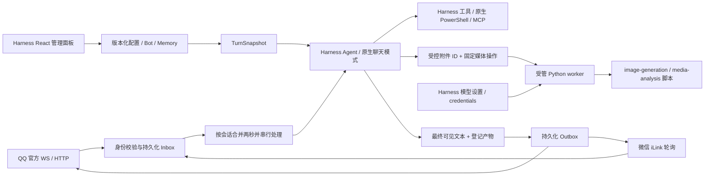

# 架构与执行约束

## 对象

- `BotConfig`：稳定 ID、人格、版本、聊天与分析模型引用、可选图片变量覆盖、工具和技能、图片风格。
- `BotInstance`：固定渠道身份、凭据引用、可信用户、启停和配置绑定。配置共享不共享身份或数据。
- `TurnSnapshot`：在原生 `turn/start` 冻结配置；原生模型选择接口控制本轮全部步骤。模型切换通过 Harness 记录，不重载插件或对已聊天 Agent 调用模式切换。
- `SessionBinding`：bot、平台、账号、群／私聊、会话位置、发送者的组合哈希。QQ 群内按发送者隔离。`/reset` 增加代次并更换 Harness session。
- `Asset`：按作用域授权的附件 ID；worker 输入只能由宿主解析，模型不能提交路径或脚本。
- `Delivery`：会话、源事件、轮次和输出序号确定唯一 ID。`sent` 表示渠道接受，非手机阅读回执。

## 数据与恢复

SQLite WAL 保存配置版本、bot、inbox、binding、outbox、媒体任务、偏好与来源删除标记。原生会话日志和附件服务由 Harness 保存。主 Agent idle 后显式执行 `sessions.flush`，随后原子写入 outbox 与 inbox 完成状态。

启动时先取得数据目录运行所有权，随后将遗留 `processing` 置为 `interrupted`，将遗留 `sending` 置为 `unknown`。不重新执行结果未知的模型／媒体任务。若在原生会话已落盘、outbox 尚未提交之间崩溃，可能没有平台回复；面板保留中断状态以便人工核对。

`unknown` 不自动重发，并冻结同轮后续输出，避免文本回执未知后继续发图。其他 bot 的发送队列独立。停止会取消待处理／暂存输入、未发投递、在途可取消工作和当前 bot 的连接；已完成外部操作不能回滚。

## 权限

工具调用执行时取“本轮冻结权限”和“当前有效权限”的交集。可信身份只来自渠道，且限私聊。原生子 Agent 按 Harness 运行所有权识别并单独绑定冻结配置；作用域 guard 与全局执行 guard 同时检查身份，取消沿运行所有权关系向子树传播。

业务工具、技能工具与获准的本机能力分别检查。撤权遍历原生运行所有权下的主／子 Agent；即使父轮已经结束，子任务仍按自己的冻结权限取消。图片变量和分析模型引用在本轮固定，原生提供商 URL 与凭据按任务读取；关闭能力立即阻止后续调用。技能目录仅公布打包技能，`skill` 在 Agent 作用域被安全版本遮蔽，不读取全局列表或私人技能正文。技能不能授予权限。受控 worker 使用固定操作、限定输入、干净环境和截止时间，进程树可取消；一般命令由 Harness 执行。

`HarnessMediaProvider` 按 `llm.listConfigurableProviders()` 的命名空间和路径读取原生 settings，通过 credentials service 解析所选提供商的密钥引用或 API key record。媒体任务仅暂存固定的内部环境变量名，密钥值只注入 worker 环境。面板返回就绪布尔值与模型名，不返回密钥。`media-analysis/scripts/media_api.py` 是音频／视频分析入口；语音合成和重复的 ASR／视频连接设置已移除。

人格和模型在当前轮次固定；撤权即时检查。原生权限 setter 会追加日志，因此在 `agent/pre-step` 应用已冻结的权限，不能在 `turn/start` 事件发布期间重入日志。

管理 HTTP API 仅接受本机连接、同源 JSON POST 和每次启动的随机 bearer；token 经 Harness 页面注入，只在本机使用。平台凭据保存在 Harness credentials service，状态 API 不返回凭据正文。

## 参考与复用

实现基于 Harness 原生 `agents`、`agentPresets`、`systemPrompt.section`、模型选择、工具 guards、scope 继承、session persistence 和 credentials 服务。

参考：DeepSeek Harness `687f282e8625c6b8d11ff58211a90524be2e4317`、MIT dsh-wechat `e0e8cb3d4c4376b15c598d4843b52b44ce8dac38`、QQ 官方插件 `89988812442583bf47c34b89f9abf5fd4b85df0b`、腾讯 iLink npm 包 2.4.10。AstrBot `f2404c191716a64daaa422be7f3c567cace50d39` 只作行为参考，未复制其 AGPL 运行时或未授权 QQ connector。

当前版本的正式渠道兼容性取决于后续实测，源码协议参照不是平台验收结论。
