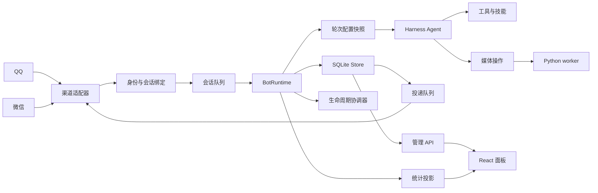

# 项目架构

本项目是一个运行在 DeepSeek Harness 中的 QQ / 微信机器人插件。Harness 负责 Agent 循环、会话历史、模型调用、工具执行和生命周期；插件负责渠道接入、身份绑定、人格配置、媒体能力、持久化和管理面板。模块职责、允许／禁止的静态依赖方向、composition root 例外和扩展规则见[架构边界契约](architecture-boundaries.md)。

独立安装的共享运行存储位于工作区根目录 `.runtime/`，安装器迁移旧 `sessions`、`storages`、`attachments` 并更新原生后端配置。每个渠道作用域的工作目录默认由机器人 ID 和 scope key 分层；附件按类型、用途和日期分类，数据库保存实际工作区及路径，读取仍核对作用域归属。媒体 worker 的 cwd、用户目录和临时目录限定在该工作区的单次任务目录，完成后清理。每轮结束导出结构化聊天记录到 `history/`，配置变更时移动旧导出，原始引擎日志仍是会话恢复的依据。

## 运行链路

## 核心边界

- **渠道适配器**：将平台事件转换为统一消息，并在发送前恢复平台目标信息。
- **身份绑定**：由渠道身份、账号、会话类型和发送者组成作用域；模型不能提供身份或路径。
- **BotRuntime**：协调接收、排队、命令、Harness turn、权限和投递。
- **配置快照**：每轮开始时冻结人格、模型、工具、技能和媒体能力；后续修改从下一轮生效。
- **Store**：保存 bot、人格版本、会话绑定、任务、投递、媒体记录和统计事件。
- **媒体 worker**：实现统一位于 `python/dsh_bot_runtime/`，只接受宿主解析后的附件和固定操作；宿主以受控包根和 `-P -m` 启动，凭据按任务注入，不写入配置或结果。
- **管理 API**：提供摘要、分页查询和受保护命令；面板只使用 API，不直接访问存储层。
- **生命周期协调器**：是独立 bundle，不是主插件内部服务。其可构建源码、integrity、protocol 和入口位于 `packages/bot-lifecycle/src/`；主插件只连接中立 runtime port。双方按 runtime protocol、coordinator API、package version range、capabilities、instance 与 artifact identity 双向握手；不兼容组合 fail closed，不把生命周期状态交给可变插件逻辑。

## Lifecycle 更新边界

独立产品 profile 在启动前核对 `installation.json` 和独立的 `lifecycle-installation.json`：两份归档 hash、实际安装 identity、package version 与 contract 必须一致。当前 coordinator 明确接受 candidate 主包时，才允许排空后只热替换主包；涉及 coordinator API、protocol major、package range 或 required capability 变化时，旧 coordinator 不会替换自己，必须由 launcher 停机后运行可信安装器离线安装两个 bundle。失败时只使用 hash 仍匹配的 previous 主包与 coordinator 各回滚一次。详见 [ADR 0004](adr/0004-lifecycle-bundle-compatibility.md)。

## 配置与人格

每个人格由 `config.json` 和 `persona.md` 组成。SQLite 中的配置版本是运行时权威快照，文件是编辑入口。应用文件或保存面板配置时会校验 schema、版本和文件指纹，并生成新的生效版本。

bot 可以共享人格，但身份、会话、附件、记忆和投递始终按渠道作用域隔离。人格或模型切换不会重载当前轮；正在执行的主任务和子任务继续使用启动时的快照。

渠道授权由 `src/harness/credentials.ts` 适配 Harness 凭据服务。符合 Harness 键格式的机器人 ID 沿用 `bot-integration/<id>`；其余合法 ID 使用独立的 `bot-integration-encoded` 作用域，键名为 `id-` 加原始 ID 的 UTF-8 十六进制编码。读、写、删除使用同一映射，纯数字、大写和下划线 ID 不会破坏面板查询，也不会与已有凭据发生键冲突。

`bot.delete` 先禁用并归档机器人，复用停止流程取消连接、模型处理和待投递消息，再删除授权、停止关联自动化并等待所有写入结束。通过固定版本 JSONL 后端的 locate 定位原生会话目录，释放会话后删除日志及投影缓存，并通过公开搜索接口刷新索引；清除插件数据库中该机器人的消息、会话、记忆、附件、任务和统计记录。仅保留机器人身份墓碑及共享人格，用户自定义工作目录保留。管理列表过滤已删除项，普通保存和连接操作不能恢复它。清理失败时恢复为可重试的停止状态；删除会清除扫码尝试，等待中的扫码和连接操作在恢复执行前重新检查机器人状态。

## 权限模型

权限由渠道身份、人格授权和当前运行状态共同决定。可信身份仅来自渠道事件，并限定在私聊场景。工具执行前检查冻结权限与当前权限的交集；撤权会阻止后续调用并取消可取消工作。

## 媒体与产物

图片、音频、视频和文件都通过统一媒体操作注册表进入 worker。worker 不接受模型提交的路径或脚本。成功、失败和结果未知的任务都会写入投递与统计记录；只有能确认请求未建立的网络错误才会自动重试。

投递记录同时承担稳定的投递意图和恢复入口。相同作用域的同一 Asset 只登记一个未决或已接受的意图；跨轮次再次登记会返回已有状态，不会生成新的平台请求。`unknown`/`failed` 会复用原记录和原平台身份；只有明确恢复或重新请求才创建新的投递意图。前序投递进入 `unknown` 或 `failed` 后不再永久阻塞同轮后续输出，避免文字回执不确定时把图片留在 pending。QQ 的上传凭据和微信 CDN 上传元数据随投递尝试保存，以便恢复时复用；提交阶段只有 DNS、路由不可达、连接拒绝或连接建立超时等明确未建立请求的错误才自动退避重试两次，其他提交失败仍保持 `unknown`，并记录底层 `cause.code`。

### Skill 操作声明

`media-analysis/operations.json` 是该技能的工具参数、参数到操作的映射、模型角色、配额、来源约束和自动附件交付的唯一声明。构建时从 `skills/*/operations.json` 生成带摘要的不可变 Host registry，框架启动只导入该内存 registry，不扫描 skill 文件；Python worker 在首次 skill 操作时验证已安装声明中的固定 `dsh_bot_runtime.skills...` entry，再用唯一包名导入 `execute(job)`。任务只传操作 ID，不接受调用方提供模块、脚本或包路径；人格、聊天输入和工作区文件均不参与 Python 代码发现。

新增媒体操作时，修改对应技能的声明、Python 实现与说明即可。每个技能的 `tools` 数组声明一个或多个工具，各自包含 `tool`、`routes`、`defaults`，以及可选的 `enabledRoles` 和 `permissionTool`。`routes` 按顺序匹配参数，`defaults` 补充省略的选择参数；操作上的 `role` 选择 `asr`、`video` 或 `tts` 模型连接，未声明则不注入模型凭据；`deliver` 将结果附件登记到本轮回复。一个操作归属一个工具，可由该工具的多个路由指向；兼容工具 `bot_media` 复用操作的来源约束、权限和附件交付行为。

`media_transform(operation, inputs, ...)` 归属 media-analysis，但不依赖分析模型角色，也不消耗每日媒体调用配额。`localTransform` 操作使用进程内共享的执行槽位，容量为 `min(4, availableParallelism())`。图片占一个槽位，GIF 取得最多两个当前空闲槽位；无空闲槽位的任务 FIFO 排队，排队取消立即移除。宿主分配的 `processingSlots` 位于 worker 协议顶层，模型参数不能覆盖。任务等待和运行期间均可取消，执行前重新检查当前权限；重启将排队和运行中的媒体作业标记为中断，不重放。非本地转换操作保留原有全局两任务、同作用域一个任务的限制。

可信私聊用户的媒体操作免除每日调用和视频分析累计秒数配额。`MediaService` 同时核对宿主传入的本轮 `TurnSnapshot`、真实聊天绑定和执行时的可信名单；新增信任延至下一轮，撤销立即生效。免额判定通过 worker 协议顶层布尔字段 `dailyQuotaExempt` 传给视频服务，模型工具参数无法设置该字段。视频服务仍记录作业和用量，大小、单次 300 秒、并发、存储及身份隔离保持原有规则。群聊和非可信私聊继续按原每日配额处理。

图片脚本在一次解码后组合方向校正、缩放、格式转换和质量压缩。GIF 脚本根据输入定位和统一帧时间网格并行编码约 15 秒的片段，30 秒以下或只有一个槽位时整段编码。每段以完整不透明首帧开始，保留帧局部调色板；合并器解析本次生成的 GIF 块，复制压缩像素并统一百分之一秒帧延时和循环信息，不重编码像素。最终文件须严格小于 10,000,000 字节，超限最多四轮降低质量，不缩短所选时长或降至 12 fps 以下。成功文件全量解码验证后登记 Asset，宿主随后清理该转换任务目录；清理失败写入任务的 `cleanupError`。

入站音频优先使用渠道提供的转写；没有转写时，BotRuntime 在送入模型前自动调用 ASR，并把真实转写写回当前消息。自动转写失败会停止本轮模型调用，避免根据未识别音频猜测内容。语音输出由 `voice-generation` skill 生成 `audio` Asset，再沿现有投递队列发送。QQ 在渠道发送准备阶段派生 SILK 语音气泡，超过 300 秒时完整分段并另附整曲 MP3，各段独立保存投递状态；微信首期使用可播放的普通音频文件。

人格配置只接受 V4。`media.voice` 使用 `profileRef` 选择 GPT-SoVITS 服务，或通过 `protocol: edge_tts` 使用内置语音；`replyMode` 支持 `on_demand` 与 `auto`。服务地址、模型权重、参考音频和语言保存在 Profile 的私有配置中，工具参数只提供朗读文本、语速等业务输入。

GPT-SoVITS 适配器按服务地址串行执行，每个请求完整执行 `set_sovits_weights → set_gpt_weights → set_refer_audio → tts`。运行任务绑定冻结的 Profile 修订版本；权限撤销、取消及会话身份检查由宿主管理。

自动语音在成功取得最终回复后、分段入投递队列前生成，正常聊天和自动化使用同一处理方式。`HarnessResult.voiceAttempted` 记录本轮显式语音尝试，失败也不会自动再合成。投递队列只重发已登记资产；普通合成失败保留正文，权限撤销或上下文失效终止投递。管理状态把配置完整性与当前人格修订版本的合成验收记录分别展示。

命名空间 skill 模块提供 `execute(job)`，返回统一的文本、附件和覆盖范围结果。只有 `dsh_bot_runtime` 自身定义且格式有效的业务 `code` 可跨进程；未知异常统一映射到稳定 fallback，不输出类型名、traceback、解释器路径、endpoint、credential、模型路径或下载 locator。

框架继续负责轮次权限交集、会话附件 ID 解析、模型凭据、音频格式适配、配额、取消、产物路径校验及投递。人格自定义技能目录不参与可执行入口发现；Python 只发现随包 `operations.json` 声明的固定 entry。损坏的可选声明只使其自身操作返回稳定错误，不阻断 document、image 或其他 skill；更新后重启生效。图片生成的每轮一次规则、原生图片理解、文档和 MP4 转码仍保留其现有宿主实现；`convert_gif` 由技能提供。

### GPT-SoVITS Limitations / Known Issues

服务需要由一个机器人进程独占，首次使用及变更旧参考文本的语言/前端含义前须重新启动服务清空缓存。每次加载模型有额外耗时；取消本地 worker 不证明服务端推理立即停止。服务端模型资源和版本能力须单独配置与验收。

### RVC 音色转换

`media.singing` 是独立、默认关闭的 STS 配置，与 `media.voice` 不共享目标权重或参考音频。`bot_sing` 同时要求人格开启 STS、允许该工具并启用 `singing-conversion`。专用工具维护 `prepare/list/convert` 候选和单轮 attempt；兼容工具 `bot_media` 禁止调用 `singing_convert`。服务地址、角色路径和 job ID 由宿主提供，工具参数不能覆盖。

候选保存于 Store records，绑定 scope、session、generation 和候选集 ID。宿主解析当前会话的 audio/file 附件，或保留真实搜索结果的公开 URL、标题及可得许可信息。worker 复用公开链接下载与音轨提取；已知混音且无分离配置在下载前拒绝，类型未知要求用户确认。RVC Profile 的私有 `separation` 保存分离模型 ID、权重路径、伴奏混音开关和音量；默认关闭，配置完整后才允许 `mixed`，并先提取人声再转换和按偏好混音。明确的用户转换请求及待上传状态可绕过前置 ASR，普通语音仍自动转写。

宿主按规范化服务地址串行执行；`rvc_http_v1` 服务另有单槽 FIFO，每个作业创建专用 RVC 子进程。runner 使用已安装 RVC 包的 `VoiceConverter`，校验 checkpoint 版本、F0、speaker 和索引维度，再执行 RMVPE 转换。提交使用宿主生成的唯一 job ID；重复 ID 复用已有状态，提交响应丢失只查状态，不重放推理。取消由仍存活的宿主发往服务，确认子进程树结束才释放队列；状态未知时封锁该服务，确认空闲后恢复。

服务返回 WAV 字节，机器人媒体 worker 编码 MP3/WAV，检查完整解码、有效帧、非静音、源/结果时长和大小。单次成功只登记一个当前会话 audio Asset，沿已有持久投递队列发送。失败、取消和未知状态不会自动换源或重跑；已有 STS 尝试令 `HarnessResult.singingAttempted` 为真，停止该轮额外的自动 TTS。实时权限与会话身份在排队、执行、结果登记前复核。

管理状态分别报告配置完整性、RVC 协议验证、分离协议/模型完整性和 `singing` 真实转换验收，后两者绑定人格 ID 和 revision。`skill.singing.probe` 只访问 `/health` 检查协议，不启动推理；真实音色验收由运营者根据完整输出与试听登记。模型可见的配置投影剥离 RVC 服务地址、RVC/分离模型路径。

## 面板

面板按“总览、机器人、配置”组织功能，显示运行状态、bot 状态、人格配置、媒体能力和统计。所有写操作经过管理 API，配置变更在下一轮生效。
