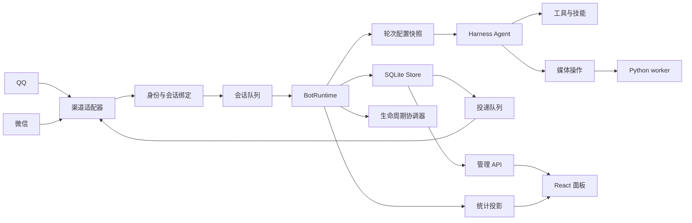

# 项目架构

本项目是一个运行在 DeepSeek Harness 中的 QQ / 微信机器人插件。Harness 负责 Agent 循环、会话历史、模型调用、工具执行和生命周期；插件负责渠道接入、身份绑定、人格配置、媒体能力、持久化和管理面板。

## 运行链路

## 核心边界

- **渠道适配器**：将平台事件转换为统一消息，并在发送前恢复平台目标信息。
- **身份绑定**：由渠道身份、账号、会话类型和发送者组成作用域；模型不能提供身份或路径。
- **BotRuntime**：协调接收、排队、命令、Harness turn、权限和投递。
- **配置快照**：每轮开始时冻结人格、模型、工具、技能和媒体能力；后续修改从下一轮生效。
- **Store**：保存 bot、人格版本、会话绑定、任务、投递、媒体记录和统计事件。
- **媒体 worker**：只接受宿主解析后的附件和固定操作，凭据按任务注入，不写入配置或结果。
- **管理 API**：提供摘要、分页查询和受保护命令；面板只使用 API，不直接访问存储层。
- **生命周期协调器**：独立处理升级、重启、回退和恢复，不把生命周期状态交给可变插件逻辑。

## 配置与人格

每个人格由 `config.json` 和 `persona.md` 组成。SQLite 中的配置版本是运行时权威快照，文件是编辑入口。应用文件或保存面板配置时会校验 schema、版本和文件指纹，并生成新的生效版本。

bot 可以共享人格，但身份、会话、附件、记忆和投递始终按渠道作用域隔离。人格或模型切换不会重载当前轮；正在执行的主任务和子任务继续使用启动时的快照。

## 权限模型

权限由渠道身份、人格授权和当前运行状态共同决定。可信身份仅来自渠道事件，并限定在私聊场景。工具执行前检查冻结权限与当前权限的交集；撤权会阻止后续调用并取消可取消工作。

## 媒体与产物

图片、音频、视频和文件都通过统一媒体操作注册表进入 worker。worker 不接受模型提交的路径或脚本。成功、失败和结果未知的任务都会写入投递与统计记录，结果未知的付费操作不会自动重试。

## 面板

面板按“总览、机器人、配置”组织功能，显示运行状态、bot 状态、人格配置、媒体能力和统计。所有写操作经过管理 API，配置变更在下一轮生效。
