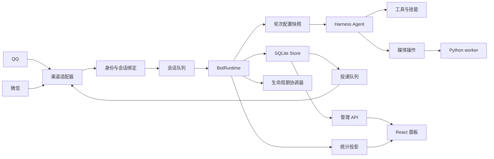

# 项目架构

本项目是一个运行在 DeepSeek Harness 中的 QQ / 微信机器人插件。Harness 负责 Agent 循环、会话历史、模型调用、工具执行和生命周期；插件负责渠道接入、身份绑定、人格配置、媒体能力、持久化和管理面板。

## 运行链路

## 核心边界

- **渠道适配器**：将平台事件转换为统一消息，并在发送前恢复平台目标信息。
- **身份绑定**：由渠道身份、账号、会话类型和发送者组成作用域；模型不能提供身份或路径。
- **BotRuntime**：协调接收、排队、命令、Harness turn、权限和投递。
- **配置快照**：每轮开始时冻结人格、模型、工具、技能和媒体能力；后续修改从下一轮生效。
- **Store**：保存 bot、人格版本、会话绑定、任务、投递、媒体记录和统计事件。
- **媒体 worker**：只接受宿主解析后的附件和固定操作，凭据按任务注入，不写入配置或结果。
- **管理 API**：提供摘要、分页查询和受保护命令；面板只使用 API，不直接访问存储层。
- **生命周期协调器**：独立处理升级、重启、回退和恢复，不把生命周期状态交给可变插件逻辑。

## 配置与人格

每个人格由 `config.json` 和 `persona.md` 组成。SQLite 中的配置版本是运行时权威快照，文件是编辑入口。应用文件或保存面板配置时会校验 schema、版本和文件指纹，并生成新的生效版本。

bot 可以共享人格，但身份、会话、附件、记忆和投递始终按渠道作用域隔离。人格或模型切换不会重载当前轮；正在执行的主任务和子任务继续使用启动时的快照。

## 权限模型

权限由渠道身份、人格授权和当前运行状态共同决定。可信身份仅来自渠道事件，并限定在私聊场景。工具执行前检查冻结权限与当前权限的交集；撤权会阻止后续调用并取消可取消工作。

## 媒体与产物

图片、音频、视频和文件都通过统一媒体操作注册表进入 worker。worker 不接受模型提交的路径或脚本。成功、失败和结果未知的任务都会写入投递与统计记录；只有能确认请求未建立的网络错误才会自动重试。

投递记录同时承担稳定的投递意图和恢复入口。相同作用域的同一 Asset 只登记一个未决或已接受的意图；跨轮次再次登记会返回已有状态，不会生成新的平台请求。`unknown`/`failed` 会复用原记录和原平台身份；只有明确恢复或重新请求才创建新的投递意图。前序投递进入 `unknown` 或 `failed` 后不再永久阻塞同轮后续输出，避免文字回执不确定时把图片留在 pending。QQ 的上传凭据和微信 CDN 上传元数据随投递尝试保存，以便恢复时复用；提交阶段只有 DNS、路由不可达、连接拒绝或连接建立超时等明确未建立请求的错误才自动退避重试两次，其他提交失败仍保持 `unknown`，并记录底层 `cause.code`。

### Skill 操作声明

`media-analysis/operations.json` 是该技能的工具参数、参数到操作的映射、模型角色、配额、来源约束和自动附件交付的唯一声明。框架启动时读取随安装包发布的 `skills/*/operations.json`，注册工具与媒体操作；Python worker 从同一声明找到技能内的 `execute(job)` 入口。任务只传操作 ID，不接受调用方提供脚本路径。

新增媒体操作时，修改对应技能的声明、Python 实现与说明即可。每个技能的 `tools` 数组声明一个或多个工具，各自包含 `tool`、`routes`、`defaults`，以及可选的 `enabledRoles` 和 `permissionTool`。`routes` 按顺序匹配参数，`defaults` 补充省略的选择参数；操作上的 `role` 选择 `asr`、`video` 或 `tts` 模型连接，未声明则不注入模型凭据；`deliver` 将结果附件登记到本轮回复。一个操作归属一个工具，可由该工具的多个路由指向；兼容工具 `bot_media` 复用操作的来源约束、权限和附件交付行为。

`media_transform(operation, inputs, ...)` 归属 media-analysis，但不依赖分析模型角色，也不消耗每日媒体调用配额。`localTransform` 操作使用进程内共享的执行槽位，容量为 `min(4, availableParallelism())`。图片占一个槽位，GIF 取得最多两个当前空闲槽位；无空闲槽位的任务 FIFO 排队，排队取消立即移除。宿主分配的 `processingSlots` 位于 worker 协议顶层，模型参数不能覆盖。任务等待和运行期间均可取消，执行前重新检查当前权限；重启将排队和运行中的媒体作业标记为中断，不重放。非本地转换操作保留原有全局两任务、同作用域一个任务的限制。

可信私聊用户的媒体操作免除每日调用和视频分析累计秒数配额。`MediaService` 同时核对宿主传入的本轮 `TurnSnapshot`、真实聊天绑定和执行时的可信名单；新增信任延至下一轮，撤销立即生效。免额判定通过 worker 协议顶层布尔字段 `dailyQuotaExempt` 传给视频服务，模型工具参数无法设置该字段。视频服务仍记录作业和用量，大小、单次 300 秒、并发、存储及身份隔离保持原有规则。群聊和非可信私聊继续按原每日配额处理。

图片脚本在一次解码后组合方向校正、缩放、格式转换和质量压缩。GIF 脚本根据输入定位和统一帧时间网格并行编码约 15 秒的片段，30 秒以下或只有一个槽位时整段编码。每段以完整不透明首帧开始，保留帧局部调色板；合并器解析本次生成的 GIF 块，复制压缩像素并统一百分之一秒帧延时和循环信息，不重编码像素。最终文件须严格小于 10,000,000 字节，超限最多四轮降低质量，不缩短所选时长或降至 12 fps 以下。成功文件全量解码验证后登记 Asset，宿主随后清理该转换任务目录；清理失败写入任务的 `cleanupError`。

入站音频优先使用渠道提供的转写；没有转写时，BotRuntime 在送入模型前自动调用 ASR，并把真实转写写回当前消息。自动转写失败会停止本轮模型调用，避免根据未识别音频猜测内容。语音输出由 `voice-generation` skill 生成 `audio` Asset，再沿现有投递队列发送；QQ 使用音频文件消息，微信首期使用可播放的普通音频文件，不宣称原生语音气泡。

脚本提供 `execute(job)`，返回统一的文本、附件和覆盖范围结果；可报告异常的 `code` 字段，其他异常只暴露类型名。框架不依赖技能内的异常类名。

框架继续负责轮次权限交集、会话附件 ID 解析、模型凭据、音频格式适配、配额、取消、产物路径校验及投递。人格自定义技能目录不参与可执行入口发现；已安装声明在进程启动时加载，更新后重启生效。图片生成的每轮一次规则、原生图片理解、文档和 MP4 转码仍保留其现有宿主实现；`convert_gif` 由技能提供。

## 面板

面板按“总览、机器人、配置”组织功能，显示运行状态、bot 状态、人格配置、媒体能力和统计。所有写操作经过管理 API，配置变更在下一轮生效。
