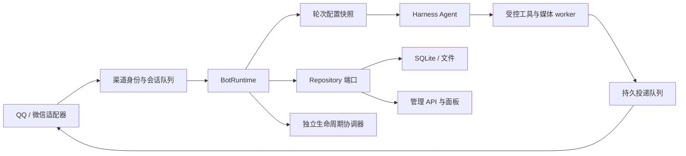

# 架构概览

简体中文 | [English](en/architecture.md)

Harness 负责 Agent 循环、模型调用、会话日志和工具执行；插件负责 QQ/微信接入、身份绑定、人格、媒体、持久化和管理面板。源码依赖与扩展规则见[架构边界](architecture-boundaries.md)，操作设置见[配置参考](configuration.md)。

## 运行链路

`src/index.ts` 组装端口和实现。应用服务通过 `src/core/ports/` 访问 SQLite/文件 adapter，面板通过管理 API 访问公共投影。媒体 worker 只接收宿主解析的输入与固定操作，不拥有身份、权限或平台投递。

## 身份、配置与权限

渠道身份拥有会话、附件、记忆和输出，模型不能指定可信身份或本机路径。bot 可以共享人格，但渠道所有权始终隔离。每轮冻结人格、模型、技能、工具和媒体配置，修改从下一轮生效；执行时还要检查当前权限，撤权立即阻止后续调用。

人格由 `config.json` 与 `persona.md` 编辑，只支持 `schemaVersion: 4`，不读取、迁移或回退 V3。SQLite revision 是生效快照；应用文件时校验 schema、revision 与文件状态。机器人独立保存运行设置，切换人格保留会话历史与模型、音色和图片服务覆盖。授权凭据由 Harness credentials 管理，合法机器人 ID 经一致映射读写，避免键冲突。

普通与排队消息保留原文、当前引用和附件；附件元数据及转写放入内部上下文，时间和工作目录由运行上下文提供。工具按需披露，宿主不把原始工具 JSON 或推理内容转发给平台。

## 会话、工作区与清理

独立安装的共享运行数据位于工作区根目录 `.runtime/`。默认和自定义工作区根目录均追加 `<botId>/<scopeKey>`；Agent 使用渠道目录下的 `sessions/<sessionId>/`，普通产物放在其中的 `outputs/`，不同会话不共用工作目录。

DSH 原生日志负责完整历史与恢复；插件 SQLite 保存绑定、历史索引和投递等业务记录；总览导出按钮或 `session.export {id}` 按需生成 `history/<scope>/<sessionId>.jsonl`，不在每轮重复写入。

渠道媒体库独立于会话目录。SQLite 记录附件 ID、来源会话、渠道归属和实际路径；最近附件选择只看当前会话，显式 ID 可复用同渠道旧附件。长期记忆同样归渠道所有。

- **删除会话**：`session.delete {id}` 停止目标会话及其真实子 Agent，释放其他界面持有的实例，等待写入关闭并阻止清理期间重新载入；清除日志、投影、可读导出、会话目录与相关记录。删除当前会话后建立保留人格、模型、音色和图片服务覆盖的空白会话；删除历史会话不停止当前工作。独立 fork、渠道附件、记忆、定时任务和会话目录外的用户文件保留。
- **清理附件**：工作区页按类型、来源、截止时间筛选登记附件，提供容量统计、预览和保留标记。执行时复查 bot 归属，保护当前会话、忙碌作用域、排队/运行任务、未完成或可重试投递和保留项，不删除未注册用户文件。统计不包含 DSH 原生附件、日志与缓存；删除会话不等于释放渠道媒体容量。
- **删除机器人**：停止连接、任务和自动化，等待写入结束，再清除授权、所属会话、附件、记忆与业务记录；保留身份墓碑防止旧操作复活，也保留共享人格和其他用户文件。失败后可重试清理。
- **任务目录回收**：worker 的 cwd、用户目录与临时目录限定在单次任务目录，结束后清理。启动取得运行目录独占权后重试已终结或中断任务的清理；路径须匹配登记的工作区、scope 与 job ID。活跃任务或仍有子进程的目录保留至后续启动处理。

## 工具与媒体

| 入口 | 职责 |
| --- | --- |
| `media_download` | 从支持的分享链接下载实际媒体，返回附件 ID；默认不投递，不分析 |
| `media_analysis` | 接收附件 ID 与问题，宿主按图片、文档、音频或视频分派分析 |
| `media_transform` | 转换已有附件的格式、尺寸、质量或视频 GIF/MP4，不接收 URL |
| `image_generation` | 使用已配置的 OpenAI 兼容服务、Google Gemini 服务或 ComfyUI 工作流生成、编辑图片 |
| `bot_voice`、`bot_music`、`bot_sing` | 分别处理语音、音乐获取和 RVC 转换；复用统一任务与附件投递 |
| `bot_session` | 查询、新建、压缩或恢复会话；即时停止由宿主命令处理 |
| `bot_model`、`bot_voice_control`、`bot_image_control` | 修改当前会话覆盖，下一轮生效 |
| `bot_skills` | 修改共享人格的技能启停，影响使用该人格的会话 |

`skills/catalog.json` 与各技能 `operations.json` 声明固定入口、工具路由、参数、模型角色及交付。构建生成 Host/Python registry；宿主只派发操作 ID，Python 从受信包根导入固定 `dsh_bot_runtime` 入口。人格、工作区和模型响应不参与代码发现，技能代码不能自行发送平台消息。

媒体默认串行执行和重试，仅用户明确要求时并发；MediaService 入口最多三路，第四路返回 `MEDIA_CONCURRENCY_LIMIT`。本地转换另共享最多三个处理槽，GIF 最多占两个。等待和运行均可取消，重启中断任务不自动重放。不设每日次数或累计视频时长配额，单文件大小、单次视频分析 300 秒、权限和所有权仍适用。同一生图请求可由模型最多额外重试三次。

入站音频优先使用渠道转写，否则先自动 ASR；失败会停止本轮，避免猜测内容。自动 TTS 在最终正文后生成，本轮已尝试显式语音或 STS 时不重复合成。服务 Profile 冻结修订版本，私有地址、模型路径和凭据不进入模型投影。QQ SILK、微信音频及大小限制见[媒体投递](qq-media-delivery.md)，音色和外部服务限制见[模型库](voice-model-library.md)。

## 持久投递与未知结果

投递意图绑定 scope、session、turn 和 Asset，重复登记复用已有状态。恢复使用原附件和平台身份；上传元数据随尝试持久化。只有能确认请求未建立的连接错误才自动退避重试，提交后无法确认的结果标记 `unknown`，不能直接重放。前序 `unknown`/`failed` 不永久阻塞同轮后续输出。

取消或远端状态无法确认时，受管服务可进入 fence，须确认状态后恢复。worker 错误只返回稳定业务 code 和脱敏诊断；宿主负责结果路径、格式、大小、身份和执行时权限检查。Repository 原子性与恢复规则见[职责矩阵](repository-responsibility-matrix.md)。

## 生命周期与面板

独立产品同时安装主插件和 `dsh-bot-lifecycle`。协调器独立于可变主插件，通过版本化协议、capabilities 与 artifact identity 握手；launcher 核对安装记录和归档身份。兼容时可排空后热替换主包，不兼容组合须停机双包升级；失败只对仍匹配的 previous 归档回滚一次。详见 [ADR 0004](adr/0004-lifecycle-bundle-compatibility.md)。

面板按总览、机器人、服务、人格和自动化组织；机器人运行、媒体、授权和工作区独立管理。写操作经过管理 API，UI 不直接访问数据库。第三方 Service Adapter ABI 尚未开放，原因与重新评估前提见[适配器边界](service-adapter-abi-threat-model.md)。
