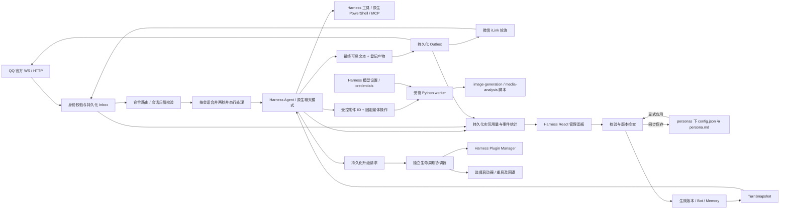

# 架构与执行约束

## 对象

- `BotConfig`：稳定 ID、人格、版本、聊天与分析模型引用、可选图片变量覆盖、工具和技能、图片风格。
- `BotInstance`：固定渠道身份、凭据引用、可信用户、启停、配置绑定与可选工作目录。配置共享不共享身份或数据；自定义目录只影响指定 bot。
- `TurnSnapshot`：在原生 `turn/start` 冻结配置；原生模型选择接口控制本轮全部步骤。模型切换通过 Harness 记录，不重载插件或对已聊天 Agent 调用模式切换。
- `SessionBinding`：bot、平台、账号、群／私聊、会话位置、发送者的组合哈希，指向当前活动会话。QQ 群内按发送者隔离。
- `SessionRecord`：持久化会话归属、人格覆盖、模型覆盖和最近附件范围。`/new`、`/reset` 更换 Harness session，保留人格、模型和长期记忆。`/resume` 先验证归属及日志可读性，再更新活动绑定。
- `Asset`：按作用域授权的附件 ID，并在保存前关联真实活动会话。最近附件自动选择限当前会话；旧数据无法证明会话归属时仅允许按作用域显式引用。worker 输入只能由宿主解析，模型不能提交路径或脚本。
- `Delivery`：会话、源事件、轮次和输出序号确定唯一 ID。`sent` 表示渠道接受，非手机阅读回执。

## 数据与恢复

SQLite WAL 保存配置版本、bot、inbox、binding、outbox、媒体任务、偏好与来源删除标记。原生会话日志和附件服务由 Harness 保存。主 Agent idle 后显式执行 `sessions.flush`，随后原子写入 outbox 与 inbox 完成状态。

有效配置统一按“会话人格覆盖 → bot 默认人格”取人格，再应用临时会话模型覆盖；人格切换清除模型覆盖，下一轮生效。提示词、工具、动态技能和媒体选择使用同一解析结果。旧历史只从可信绑定或投递记录补录，不扫描日志猜测归属。

命令在模型前处理；反馈进入同一持久化 outbox。基础命令只管理当前渠道身份的会话，维护及配置命令检查可信私聊身份。`/compact` 使用可取消的 Harness 原生命令，接收循环可继续响应 `/stop`。升级排空时消息继续入队，在途任务仍能被 `/stop` 取消；协调器等待任务、子任务、控制操作及投递全部结束。

`PersonaFiles` 管理独立数据目录下的 `personas/<id>/config.json` 和 `persona.md`，分别保存结构化设置与人设正文。文件是编辑入口，SQLite 的 config / config-version 是生效快照；每轮只读已应用的数据库配置，不自动扫描并应用文件。初次导出保持已有版本，已有草稿保留。标准 storages/bot-integration 布局使用同一产品根目录的 personas；自定义存储布局使用 dataDir/personas。

面板保存与文件应用均先校验模型，随后检查预期 revision；文件应用另校验完整文件指纹，防止异步模型校验期间文件变化。面板保存要求文件与上次同步指纹相同，避免覆盖外部草稿。文件 JSON 拒绝未知顶层字段，目录只接受受限 ID，不接受客户端路径；目录和文件不能是符号链接。身份、会话、凭据和用户 ID 不导出到人格文件。

保存时先持久化包含前后文件内容的 .pending.json，再用临时文件替换两份正文，最后在 SQLite 事务中更新生效配置、历史版本与文件指纹。数据库提交失败时恢复原文件；进程中断后根据已提交配置决定补完文件或恢复原文件。若文件已出现日志之外的修改，停止恢复并保留现场。文件与数据库不构成跨存储原子事务，该日志提供可核对的恢复路径；目录读者可能短暂看到替换中的内容，不应在此期间修改文件。

默认工作区位于安装仓库的 `.runtime/workspaces/<scope-key>`，由安装时持久化的 `workspace.json` 和启动环境传递，排除在 Git 和发布包之外。自定义工作目录属于 bot 实例；每轮开始前通过 Harness 原生 `workingDirectory.set` 切换并持久记录，session 和历史不变，在途任务及子任务保留原目录。只有面板管理员可以修改目录或请求本机打开固定的 SQLite 配置目录；普通用户的文件权限不因此扩大。

启动时先取得数据目录运行所有权，随后将遗留 `processing` 置为 `interrupted`，将遗留 `sending` 置为 `unknown`。不重新执行结果未知的模型／媒体任务。若在原生会话已落盘、outbox 尚未提交之间崩溃，可能没有平台回复；面板保留中断状态以便人工核对。

`unknown` 不自动重发，并冻结同轮后续输出，避免文本回执未知后继续发图。其他 bot 的发送队列独立。停止会取消待处理／暂存输入、未发投递、在途可取消工作和当前 bot 的连接；已完成外部操作不能回滚。

## 权限

工具调用执行时取“本轮冻结权限”和“当前有效权限”的交集。可信身份只来自渠道，且限私聊。原生子 Agent 按 Harness 运行所有权识别并单独绑定冻结配置；作用域 guard 与全局执行 guard 同时检查身份，取消沿运行所有权关系向子树传播。

业务工具、技能工具与获准的本机能力分别检查。撤权遍历原生运行所有权下的主／子 Agent；即使父轮已经结束，子任务仍按自己的冻结权限取消。图片变量和分析模型引用在本轮固定，原生提供商 URL 与凭据按任务读取；关闭能力立即阻止后续调用。技能目录只公布当前人格启用的内置技能和动态技能，`skill` 在 Agent 作用域被安全版本遮蔽，不读取全局列表或私人技能正文。技能不能授予权限。受控 worker 使用固定操作、限定输入、干净环境和截止时间，进程树可取消；一般命令由 Harness 执行。

`HarnessMediaProvider` 按 `llm.listConfigurableProviders()` 的命名空间和路径读取原生 settings，通过 credentials service 解析所选提供商的密钥引用或 API key record。媒体任务仅暂存固定的内部环境变量名，密钥值只注入 worker 环境。面板返回就绪布尔值与模型名，不返回密钥。`media-analysis/scripts/media_api.py` 是音频／视频分析入口；语音合成和重复的 ASR／视频连接设置已移除。

人格和模型在当前轮次固定；撤权即时检查。原生权限 setter 会追加日志，因此在 `agent/pre-step` 应用已冻结的权限，不能在 `turn/start` 事件发布期间重入日志。

管理 HTTP API 仅接受本机连接、同源 JSON POST 和每次启动的随机 bearer；token 经 Harness 页面注入，只在本机使用。平台凭据保存在 Harness credentials service，状态 API 不返回凭据正文。

## 动态技能与升级

动态技能草稿位于人格目录的 `skills/<name>/`，发布后保存至内容寻址的 `skill-versions/`。`SKILL.md`、脚本及资源作为完整版本冻结，主任务和子任务保留开始时的资源目录；新轮次读取新的技能目录。内置技能名称不能覆盖。发布同时检查人格 revision、人格文件指纹和技能草稿指纹；回退前检查手工草稿冲突，失败时保留归档并恢复已经更换的草稿。

`bot_evolve` 由真实渠道身份派生人格和任务归属，执行及异步验证返回后再次检查可信私聊和本机工具权限。插件候选位于源码项目 `.codex/evolution/<任务ID>/`，保留已有工作区变更。源码基线、安装来源、候选指纹和安装制品 SHA256 均写入任务记录；校验后再修改候选会使应用失效。

`dsh-bot-lifecycle` 是独立安装的 bundle，协调器、启动器和固定验证入口不属于自修改目标。工具只持久化升级请求后返回，协调器跨目标 bundle 卸载存活，等待排空后调用 Plugin Manager 替换包。热激活无法确认时通过认证 IPC 请求其监督启动器重启，核对新包身份和健康状态；失败最多恢复上一归档一次。重启、回退和中断恢复不覆盖会话、统计或投递数据库，因此自动升级须保持旧版数据可读。网络连接状态独立于插件激活结果。

## 统计

统计服务收集 Harness 原生主／子任务请求、压缩流事件和媒体请求 sidecar，记录实际 provider/model、调用类别和报告的 usage。使用原生请求或媒体调用 ID 去重，真实重试分别计数；缺失字段保持未知。输入、输出、缓存读写分开，推理 token 不重复加入总量。本地转码和平台转写不生成模型调用记录。

接收消息以平台事件身份去重，发送以平台接受的实际文本片段或附件计数；结果未知、失败和取消单独保留。历史发送缺少时间时不借用接收时间。统计按 Asia/Shanghai 分日，自定义范围采用包含起点、不包含终点的区间。QQ 群名单来自已观察消息和可确认加入／退出事件，完整性始终未知；微信 iLink 显示群聊不支持。

面板、本机认证 API `stats.query`、`bot_stats` 和 `/stats` 共用查询服务。聊天入口只接受可信私聊，允许查询所有 bot，执行时再次检查撤权；普通私聊和群聊全部拒绝。在线状态使用连接、心跳或成功轮询证据，不以进程启动代替上线。

## 参考与复用

实现基于 Harness 原生 `agents`、`agentPresets`、`systemPrompt.section`、模型选择、工具 guards、scope 继承、session persistence 和 credentials 服务。

参考：DeepSeek Harness `687f282e8625c6b8d11ff58211a90524be2e4317`、MIT dsh-wechat `e0e8cb3d4c4376b15c598d4843b52b44ce8dac38`、QQ 官方插件 `89988812442583bf47c34b89f9abf5fd4b85df0b`、腾讯 iLink npm 包 2.4.10。AstrBot `f2404c191716a64daaa422be7f3c567cace50d39` 只作行为参考，未复制其 AGPL 运行时或未授权 QQ connector。

当前版本的正式渠道兼容性取决于后续实测，源码协议参照不是平台验收结论。
