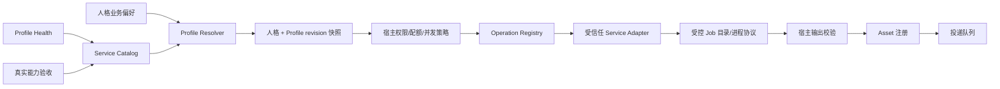

# 能力边界、模型目录与服务插件化实施计划

日期：2026-11-02
修订：计划审计修订版 2
状态：已完成架构审计，待契约、信任边界和迁移恢复语义冻结

> 本文是可执行迁移计划，不是当前实现状态的声明。除“当前实现基线”章节外，其他章节描述目标设计和必须满足的阶段门槛。
>
> 文档不得记录真实本机路径、服务端点、模型库存、用户 ID、凭据或下载 locator。部署实例使用 `<BOT_TTS_HOME>`、`<BOT_RVC_HOME>`、`<BOT_MUSIC_HOME>`、`<LOCAL_MODEL_ROOT>` 等占位符；真实迁移清单只保存在包外的本机运维记录中。

## 1. 目标、范围与不可变决策

本计划将 QQ/微信 Bot 的业务能力、外部推理服务、模型资源、服务配置和安装方式解耦，同时保持以下宿主边界：

- DSH 插件负责渠道、身份、会话、人格快照、权限、任务、附件、Asset、投递、统计、管理 API 和生命周期。
- 外部服务项目保持独立环境、独立测试和独立升级；插件不复制外部服务源码或模型权重。
- 人格保存业务选择和少量偏好；图片生成可保存 HTTPS 服务地址、模型名和密钥环境变量名，实际密钥留在后台环境。其他服务型能力不保存端口、服务地址、模型路径、权重路径、凭据、下载 locator 或内部句柄。
- 服务通过版本化 manifest、profile、health、execute 和 cancel 契约接入。
- 宿主最终决定权限、配额、并发、取消、输出校验和自动投递；插件 manifest 只能声明需求和默认值，不能扩大宿主权限。
- 每个 profile 使用不可变 revision。人格 revision、profile revision 和 job 都要在轮次开始时冻结；运行中的任务不能因为 profile 原地修改而改变行为。
- v3 配置采用双读兼容、v4 单写；旧配置在观察期结束前不能静默删除。
- 先建立兼容 adapter 和只读发现，再迁移人格和模型资源；未经 hash、health 和真实验收，不移动或删除旧资源。
- 首期只允许宿主内置或随主包发布且固定 hash 的 adapter。第三方 adapter 首期不得以任意进程内 npm 代码加载；后续若开放，必须使用受控子进程协议和显式信任登记。

### 非目标

本计划不包括：

- 将所有外部服务强行改成同一种 RPC；
- 把外部服务源码、CUDA/RVC 重型依赖或模型权重打入 DSH npm 包；
- 在人格目录中发现或执行任意脚本；
- 通过模型参数让模型选择服务地址、路径、凭据或投递目标；
- 用一次 health 请求冒充真实媒体输出验收；
- 在没有回滚和观察期的情况下批量移动或删除用户模型。

## 2. 当前实现基线与差距

实施必须以当前代码为基线，不得把目标设计误写成已有能力。

| 领域 | 当前实现 | 目标差距 |
|---|---|---|
| 运行时能力 | `CapabilityRegistry` 负责运行时注册、授权和并发 | 需要明确它与服务 operation 的关系，不能再建一套相互独立的能力事实源 |
| 媒体 operation | `MediaOperationRegistry` 从随包技能声明加载 operation，handler 仍是固定字符串 | 需要统一内置 operation 和 service plugin operation 的注册、命名空间和策略覆盖 |
| 技能执行 | 只加载随包 `skills/*/operations.json`，人格技能目录不参与可执行入口发现 | 该安全边界继续保留；服务插件不能绕过宿主注册表 |
| Composition root | `src/index.ts` 直接创建 `MediaService`、provider、worker 和 `NativeHarness` | 需要在创建这些对象前完成 manifest 验证、catalog 构建和 adapter 生命周期管理 |
| 人格配置 | `src/core/types.ts` 仍是 schema v3，GPT-SoVITS/RVC 详细 endpoint 和路径仍在人格配置 | 需要 v3 双读、v4 单写和受管 profile 引用 |
| 轮次快照 | `TurnSnapshot` 当前主要冻结 `BotConfig` | 需要同时冻结已解析的 profile revision/content hash |
| GPT-SoVITS | 通过 TTS provider 和 worker 使用人格中的详细配置，并有服务串行队列 | 需要 profile resolver 和 adapter；保留现有协议作为兼容实现 |
| RVC | 主要使用 `rvc_http_v1` facade，并按服务地址管理未知状态 | 目标以 CLI adapter 为主，HTTP facade 仅作迁移兼容 |
| Music | `MusicProcessWorker` 接受全局 home/sources | 需要受管 Music profile、逐来源验收和正确传递歌词偏好 |
| 管理面板 | `catalog.config`、`skill.*.status/probe` 和 capability records 分散存在 | 需要统一 Catalog/Health/Acceptance API；旧 API 只能作为兼容包装 |
| 安装器 | `scripts/install.mjs` 接受本地目录或本地 tgz，并创建 media venv | 需要固定 ref/hash bootstrap、包安全校验和分层最小安装 |
| 发布文件 | `docs/` 随 npm 包发布 | 计划、README 和 release 检查不得包含真实部署信息 |

## 3. 宿主边界与数据流

### 3.1 宿主拥有的能力

以下对象和决定只能由宿主持有：

- 渠道身份、账号、会话绑定、发送目标和真实发送者；
- session、scope、generation、人格和模型轮次快照；
- 权限交集、可信私聊判断、撤权处理和当前运行状态；
- Asset ID、Asset 所属作用域、工作区、投递意图和平台回执；
- job ID、job 目录、超时、取消、幂等键、配额、并发和失败记录；
- provider 凭据解析、输出路径校验、媒体格式校验和投递队列；
- plugin allowlist、版本、hash、撤销状态和生命周期。

模型、技能脚本和外部 adapter 不得提供或修改这些对象。

### 3.2 Adapter 允许看到的内容

宿主向 adapter 提供：

- 宿主生成的 job ID 和取消信号；
- 已解析且已授权的业务参数；
- 位于 job 目录内的输入文件句柄或受控相对路径；
- 已解析的 profile revision；
- adapter 声明所需的凭据引用，凭据值只通过受控环境或进程通道注入；
- 输出必须写入的 job 目录。

adapter 不得访问：

- DSH Store、Channel Adapter、Session 对象或身份对象；
- 原始用户 ID、平台目标、投递队列；
- 任意工作区、人格目录或未登记的本机路径；
- 模型上下文中不可见的 endpoint、凭据和 locator。

第三方 adapter 若以子进程运行，只接收版本化 JSON/JSONL 请求和受控 job 目录；不能通过共享 Node 进程对象绕过该边界。

### 3.3 统一运行链路



## 4. Service Plugin 信任模型

### 4.1 首期加载规则

首期只允许以下两类 adapter：

1. 主插件内置并随主包发布的 adapter；
2. 随主包发布、固定版本、固定内容 hash 且在宿主 allowlist 中的 adapter。

不允许：

- 从人格目录、工作区或聊天输入发现可执行入口；
- 运行时下载后直接 `import` 任意 npm 包；
- 仅凭名称或 host range 判断第三方包可信；
- 让模型、普通工具或远程服务返回可执行路径；
- 将 `npm pack --ignore-scripts` 当作运行时沙箱。

### 4.2 第三方 adapter 的后续模型

若未来支持独立发布的第三方 adapter，默认使用受控子进程：

```text
宿主 ServicePluginHost
        │ versioned JSON/JSONL
        │ 受控 job 目录
        ▼
Adapter subprocess
```

进程内第三方 adapter 只有在另行完成代码审计、签名验证和显式运营者批准后才能启用；该能力不属于首期目标。

### 4.3 安装记录和撤销

每个已安装或登记的插件必须持久化：

```text
packageId
version
manifestVersion
source
artifactSha256
signature（如有）
hostApiRange
dependencies
allowlisted
revoked
installedAt
previousVersion
```

启动时按以下顺序拒绝插件：

1. 包来源不受允许；
2. archive hash 或签名不匹配；
3. manifest 版本不支持；
4. host range 不匹配；
5. 依赖缺失或版本冲突；
6. entry 越界、符号链接、junction/reparse point 或路径穿越；
7. service、operation 或 tool ID 重复；
8. 插件已撤销。

SHA-256 证明完整性，不单独证明来源可信；正式第三方发布需要固定来源和签名或固定 hash 的组合。

## 5. 稳定契约

契约应放入独立、版本化的 contract 模块；manifest、profile、job 和错误结构都必须有明确的 schema 版本和大小上限。`unknown` 不能用 `unknown` 类型代替实际运行时校验。

### 5.1 Manifest

```ts
interface ServicePluginManifest {
  manifestVersion: number;
  serviceId: string;
  packageId: string;
  version: string;
  hostApiRange: string;          // 明确使用 semver range
  entry: string;                 // 只能是包内相对路径
  protocols: readonly string[];
  capabilities: readonly CapabilityDescriptor[];
  profileSchema: SchemaRef;
  dependencies: readonly DependencyDescriptor[];
  credentialRefs?: readonly CredentialRefDescriptor[];
  artifactSha256?: string;
  signature?: string;
}

interface CapabilityDescriptor {
  operation: string;             // 统一使用 serviceId.operation 命名空间
  inputKinds: readonly string[];
  outputKinds: readonly string[];
  parameterSchema: SchemaRef;
  permission: string;             // 宿主策略的候选权限，不是最终授权
  quotaPolicy: string;
  concurrencyPolicy: string;
  deliveryPolicy: 'never' | 'host_decides' | 'allowed';
}
```

`SchemaRef` 必须包含 schema dialect/version；首期统一使用受支持的 JSON Schema 方言。`hostApiRange`、依赖和协议版本的解析规则必须由 contract 包统一实现。

### 5.2 Profile

Profile 分为两部分：

- **公共投影**：可供面板和模型看到的脱敏信息；
- **受管私有配置**：只供宿主和对应 adapter 使用。

```ts
interface ServiceProfileRef {
  serviceId: string;
  profileId: string;
}

interface ServiceProfileRevision {
  serviceId: string;
  profileId: string;
  revision: number;
  contentHash: string;
  state: 'ready' | 'partial' | 'blocked' | 'missing' | 'disabled';
  capabilities: readonly string[];
  displayName: string;
  modelLabel?: string;
  updatedAt: number;
}
```

Profile ID 必须在 service namespace 内唯一；对外展示可使用 `serviceId/profileId`，避免不同服务出现同名 profile。

Profile 私有配置必须使用受管根目录、canonical path 和服务安全策略。禁止把任意用户输入的绝对路径直接当作 profile 内容使用。

### 5.3 Adapter

```ts
interface ServiceAdapter {
  readonly serviceId: string;
  listProfiles(signal: AbortSignal): Promise<readonly ServiceProfileRevision[]>;
  health(profile: ServiceProfileRef, signal: AbortSignal): Promise<HealthResult>;
  execute(request: ServiceJob, signal: AbortSignal): Promise<ServiceResult>;
  cancel(jobId: string, signal?: AbortSignal): Promise<CancelResult>;
  dispose(): Promise<void>;
}
```

`ServiceJob` 至少包含：

```ts
interface ServiceJob {
  jobId: string;
  operation: string;
  profile: ServiceProfileRevision;
  inputHandles: readonly string[];       // 仅允许宿主解析后的句柄
  parameters: Record<string, unknown>;   // 已由宿主 schema 校验
  outputDirectory: string;                // 由宿主分配且必须在 job root 内
  idempotencyKey: string;
  deadline: number;
}
```

adapter 不得根据参数重新解析 profile、endpoint 或路径。profile 切换必须通过新的 revision 完成。

### 5.4 统一错误和取消

```ts
interface ServiceError {
  category:
    | 'NOT_CONFIGURED'
    | 'DEPENDENCY_UNAVAILABLE'
    | 'INVALID_INPUT'
    | 'TIMEOUT'
    | 'CANCELLED'
    | 'PROVIDER_ERROR'
    | 'OUTPUT_INVALID'
    | 'UNKNOWN_STATE';
  providerCode?: string;
  safeDiagnostic?: string;
  retryable: boolean;
  blocksService: boolean;
  correlationId?: string;
}

type CancelResult =
  | {state: 'cancelled'}
  | {state: 'cancel_requested'}
  | {state: 'unknown'; blocksService: true}
  | {state: 'not_supported'};
```

对外只暴露稳定 category 和脱敏 diagnostic。原始 URL、路径、凭据、traceback 和 locator 只允许出现在受控本地诊断中，并且必须经过脱敏和大小限制。

任务状态统一为：

```text
queued
running
cancel_requested
cancelled
succeeded
failed
unknown
```

进入 `unknown` 后不能自动重跑、重复投递或立即释放远程服务/GPU 锁；必须由 adapter 的 health/status 逻辑确认空闲后恢复。

## 6. Registry、策略和 Composition Root

### 6.1 单一注册入口

`CapabilityRegistry`、`MediaOperationRegistry` 和技能声明不再各自维护一套 service operation 事实源。目标关系如下：

- `ServicePluginHost`：验证插件、构建不可变 catalog、管理 adapter 生命周期；
- `MediaOperationRegistry`：保存宿主最终批准的 operation descriptor；
- `CapabilityRegistry`：把已批准 operation 映射为运行时能力，执行授权和并发；
- `NativeHarness`：只从宿主最终注册表创建工具 schema 和 handler；
- `DynamicSkills`：继续负责人格技能草稿和版本，不参与可执行 adapter 发现。

operation 必须使用 service namespace，例如：

```text
music.search
music.acquire
rvc.convert
voice.speak
```

内置 operation 和插件 operation 发生 service、operation、tool 或权限 ID 冲突时，启动失败，不静默覆盖。

### 6.2 加载顺序

在 `src/index.ts` composition root 中按以下顺序创建对象：

1. 读取随包发布或已登记的 manifest；
2. 验证来源、hash/signature、host range、依赖、路径、schema 和重复 ID；
3. 创建 immutable Service Catalog；
4. 创建 profile store/discovery 和 health cache；
5. 创建 adapter 并注册 approved operations；
6. 创建 `MediaService`、output validators 和 worker bridge；
7. 创建 `NativeHarness` 和工具 schema；
8. 启动 runtime；
9. 关闭时先停止接收新任务，再取消/排空 adapter，最后释放 worker、runtime 和 store。

任何 manifest 或 adapter 初始化失败都必须在启动阶段报告明确的安全错误；不得部分加载后继续运行一个不完整的 operation 集合。

### 6.3 宿主策略覆盖

manifest 中的权限、配额、并发和交付字段只是能力声明。宿主策略必须能收紧它们：

- adapter 不能自行增加可信身份；
- adapter 不能把 `dailyQuotaExempt`、`processingSlots` 或 delivery 标记作为用户参数；
- profile 不能修改工具权限和配额；
- 权限撤销、会话切换、profile 撤销、超时和取消必须在排队、提交、结果登记和投递前复核。

## 7. Profile、人格和轮次快照

### 7.1 v4 人格结构

v4 人格保存业务偏好，服务型能力使用 `profileRef`。图片生成保留独立连接设置：`media.image` 可保存 HTTPS `baseUrl`、模型名 `model` 和密钥环境变量名 `keyEnv`，实际密钥值来自后台环境，迁移时保留这些设置。ASR、视频等继续由 Harness 原生模型连接或宿主已有 provider 处理，只有明确接入 service plugin 时才使用 profile。

推荐结构：

```json
{
  "schemaVersion": 4,
  "media": {
    "voice": {
      "enabled": true,
      "profileRef": {
        "serviceId": "gpt-sovits",
        "profileId": "default"
      },
      "replyMode": "on_demand"
    },
    "singing": {
      "enabled": true,
      "profileRef": {
        "serviceId": "rvc",
        "profileId": "default"
      }
    },
    "music": {
      "enabled": true,
      "profileRef": {
        "serviceId": "music",
        "profileId": "default"
      },
      "includeLyrics": false
    }
  }
}
```

旧 v3 结构短期只读兼容；下一次保存只写 v4。Profile 缺失时不能静默选择另一个 profile，能力应进入 `blocked` 或 `missing` 并给出修复入口。

### 7.2 Profile 解析优先级

按以下顺序解析：

1. 人格显式 `profileRef`；
2. bot/安装级默认 profile；
3. adapter manifest 声明的默认 profile；
4. 无默认时进入 `missing`。

不会跨 service 自动回退，也不会因为 profile 不可用而悄悄切换到另一个模型。`enabled=false` 表示明确不调用；`blocked`/`missing` 表示已启用但当前不能调用，面板必须可见。

### 7.3 快照和 Job 绑定

轮次开始时解析并冻结：

```ts
interface TurnServiceSnapshot {
  serviceId: string;
  profileId: string;
  profileRevision: number;
  profileContentHash: string;
}
```

`TurnSnapshot`、job 记录、Asset 生成记录和验收记录都应包含该引用。Profile 更新产生新 revision；当前轮和已启动 job 继续使用旧 revision，下一轮才使用新 revision。

若运行期间发生以下任一事件，必须在下一处边界阻断：

- 当前能力被撤销；
- profile 被禁用、撤销或进入 blocked；
- session generation 发生变化；
- bot 被禁用或归档；
- scope 身份不再匹配。

## 8. Profile 存储、目录和路径安全

### 8.1 受管 profile 目录

Profile 目录由宿主创建和登记，使用内容 hash 或不可变 revision；不允许人格目录或聊天消息直接成为 profile 根目录。

扫描和迁移必须：

- 使用 canonical path；
- 拒绝符号链接、junction、Windows reparse point 和特殊设备文件；
- 检查路径位于允许的服务根目录内；
- 对文件大小、文件数量、目录深度和总扫描时间设限；
- 保留源文件 hash、目标文件 hash 和迁移 journal；
- 不通过文件名猜测模型版本，版本由 manifest/检查点实际校验得到。

### 8.2 服务网络策略

每个 service adapter 必须声明网络策略：

- 是否只允许 loopback；
- 允许的协议和端口范围；
- 是否允许重定向；
- DNS 解析和 rebinding 处理；
- 最大响应大小和 deadline；
- 是否允许代理；
- 凭据注入方式。

health、refresh 和 adapter 请求只能针对已登记 profile，不能接受模型或普通工具传入的任意 URL。

## 9. 各服务适配边界

### 9.1 GPT-SoVITS

首期保留已有 loopback HTTP 服务作为兼容实现，但将详细服务配置移入受管 profile：

- profile 保存模型版本、参考音频、参考文本、语言和服务实例配置；
- persona 只提交 profile 引用、文本和允许的业务覆盖；
- adapter 串行执行完整的模型/参考设置和合成序列；
- adapter 负责健康检查、输出 WAV 校验、非静音检查和诊断脱敏；
- 客户端取消不能假定服务端推理立即停止；未确认时进入 `unknown` 或保持服务锁；
- profile revision 变化必须重新进行真实能力验收。

不允许模型或用户通过工具参数覆盖本机路径、权重、服务地址或参考音频 locator。

### 9.2 RVC

目标边界为 CLI adapter：

```text
rvc convert
rvc separate infer
```

迁移期保留 `rvc_http_v1` compatibility adapter，但它不再作为人格必填的外部服务边界。

CLI adapter 必须：

- 在宿主 job 目录中运行受控子进程；
- 校验 checkpoint 版本、F0、speaker、索引维度和输入时长；
- 取消时终止完整进程树，并确认子进程释放；
- 无法确认远端/设备空闲时进入 `unknown` 并封锁相关 service instance；
- 通过统一 output validator 检查 WAV/MP3、有效帧、时长、大小和非静音；
- 不自动换源或重跑失败任务。

### 9.3 Music

Music 使用独立 profile，至少包含：

- 受管项目根目录引用；
- 来源顺序和来源启用策略；
- 歌词能力；
- profile revision；
- 每个来源的 health 和真实下载验收；
- 超时、大小和来源策略。

默认只启用已经通过完整搜索和下载验收的来源。新增来源必须单独完成 health、search、完整下载和输出校验。

`includeLyrics` 必须来自冻结的人格快照并传入 acquisition job；不能在 worker 中固定为 `true`。搜索成功不等于完整下载成功，试听片段不能登记为完整音乐 Asset。

## 10. 统一输出校验

adapter 返回的文件只能是宿主 job 目录内的文件句柄或相对路径。宿主必须重新校验内容，而不是信任 adapter 返回的 MIME。

建立 `OutputValidatorRegistry`：

- image：magic bytes、完整解码、尺寸和像素上限；
- audio：容器、有效帧、时长、采样率、非静音和大小；
- video：ffprobe、时长、流数量、编码和大小；
- file：大小、文件类型、扩展名策略和压缩炸弹防护；
- 所有类型：路径归属、文件数量、结果 JSON 大小、诊断深度和字段数量。

校验失败统一为 `OUTPUT_INVALID`，不登记 Asset，不进入投递队列。

## 11. Health、Catalog 与 Acceptance

### 11.1 Profile Health

Health 是可过期的环境状态：

```text
unknown
ready
degraded
unavailable
blocked
disabled
```

Health 只能说明当前服务和 profile 是否可被探测，不代表真实 TTS、RVC 或完整下载已经通过。

### 11.2 Capability Acceptance

Acceptance 是绑定 revision 的真实能力证据：

```text
NOT_RUN
PASS
FAIL
EXPIRED
BLOCKED
```

记录至少包含：

```text
serviceId
profileId
profileRevision
profileContentHash
personaId
personaRevision
operation
evidenceType
evidence
checkedAt
expiresAt
source
```

Profile revision、persona revision 或 operation 改变后，旧记录不能作为当前验收使用。

### 11.3 管理 API

新增统一查询和命令：

- `catalog.profiles`：分页列出脱敏 profile；
- `catalog.profile`：返回单个 profile 的公共投影；
- `catalog.models`：统一返回 provider、model、输入模态和 reasoning 能力；
- `service.health`：只检查已登记 profile；
- `service.refresh`：重新发现受管服务和 catalog；
- `capability.acceptance`：查询和登记绑定双 revision 的验收。

现有 `skill.*.status`、`skill.*.probe` 和旧 models 查询保留兼容包装，但不再各自持有独立状态。新面板只使用统一 Catalog、Health 和 Acceptance。

所有管理响应都必须剥离：

- 本机路径；
- 端口和内部 endpoint；
- 凭据；
- 下载 locator；
- 权重文件名；
- 原始 traceback。

## 12. v3 → v4 迁移方案

### 12.1 迁移原则

- 幂等：相同 v3 输入重复执行得到同一 profile 内容 hash；
- 可恢复：进程中断后根据 journal 继续或回滚；
- 可回退：profile 创建或 health 失败时旧 v3 配置仍可运行；
- 不丢失：旧人格、会话、附件、记忆、身份、统计和历史不受影响；
- 双 revision：persona revision 和 profile revision 都参与快照和验收；
- 先复制后删除：物理迁移不与配置切换绑定为不可逆一步。

### 12.2 迁移步骤

1. 读取 v3 配置并保留原始 revision 和文件 digest；
2. 规范化旧 endpoint、模型和路径，校验根目录、符号链接和文件 hash；
3. 在受管 profile store 创建候选 profile revision；
4. 复制或登记资源，记录源/目标 hash，不删除源文件；
5. 执行 profile health；
6. 对启用的 operation 执行真实能力验收；
7. 在 SQLite transaction 和 persona journal 中提交 v4 配置、profile revision 和迁移记录；
8. 让下一轮开始使用 v4；
9. 观察期内保留 v3 兼容读取和旧资源；
10. 所有旧引用消失且人工确认后，才允许单独执行资源清理。

### 12.3 迁移 Journal

迁移记录至少包含：

```text
detected
profile-created
copied
hash-verified
health-verified
acceptance-recorded
activated
failed
rolled-back
```

journal 必须记录：

- migration ID；
- persona ID 和旧 revision；
- profile ref 和新 revision；
- 源/目标 hash；
- 失败 category 和安全诊断；
- 当前阶段；
- 可重试动作；
- 创建时间和最后更新时间。

崩溃恢复时：

- 若 v4 commit 已完成，恢复 profile 和文件到 v4；
- 若 commit 未完成，恢复到 v3 或保留候选 profile 并标记 `failed`；
- 不覆盖用户在迁移期间产生的手工修改；
- 有冲突时保留现场，不静默删除。

## 13. 模型目录整理和物理迁移

### 13.1 标准目录原则

具体目录由安装实例配置，不写入发布文档。目标目录应满足：

- 稳定 ASCII ID；
- 显示名称和来源记录在 manifest；
- TTS、RVC、分离模型和共享基础模型分别命名空间；
- 版本由 manifest 和实际检查点识别，不由文件名猜测；
- 非模型日志、压缩包、输入歌曲和临时文件不进入模型目录。

### 13.2 物理移动门槛

执行物理移动前必须完成：

- 停止相关服务并取得迁移锁；
- 扫描文件、计算 SHA-256 并预检目标磁盘空间；
- 复制后再次校验 hash；
- profile health 和真实输出验收通过；
- 确认所有 active persona/job 已切换到新 profile revision；
- 写入迁移 journal；
- 保留源文件直到观察期和人工确认结束。

跨卷迁移必须使用“复制、校验、更新 profile、观察、人工确认、再删除源文件”，不能使用不可回滚的直接移动。

## 14. 安装、升级与 GitHub Bootstrap

### 14.1 当前安装器兼容范围

现有安装器继续支持本地目录和本地 tgz；这不是 GitHub 固定 ref 安装的替代品。安装过程必须保持：

- `npm pack --ignore-scripts`；
- 发布白名单；
- identity/hash 记录；
- 生命周期 bundle 独立升级和回滚；
- 不将运行数据、模型、凭据或真实 endpoint 放入归档。

### 14.2 Bootstrap 输入和状态机

后续新增 `bootstrap-github` 时只接受：

```text
Repository
Ref
Sha256 或签名
Home
SourceDir（可选）
```

规则：

- 只允许明确的 GitHub host；
- `Ref` 必须是固定 semver release tag，不接受浮动分支或 commit SHA；必须同时提供预期 SHA-256 以固定下载产物内容；
- 优先下载固定名称的 release tgz 和 hash/signature 文件；
- 下载必须有大小上限、无不受控重定向和明确超时；
- 独立校验 hash/signature 后才能调用现有安装器；
- archive 必须拒绝路径穿越、符号链接、junction/reparse point 和异常 entry；
- 临时目录放在受控临时根目录，成功和失败都清理；
- 失败保留最小可诊断 journal，不保留敏感下载内容。

安装状态：

```text
downloaded
hash-verified
archive-validated
installed
health-verified
failed
rolled-back
```

升级失败时使用上一份 hash 已验证的 archive 回滚。回滚必须由生命周期协调器执行，不由可变插件逻辑自行决定。

### 14.3 分层最小安装

安装分为：

```text
core runtime
basic media
voice-generation optional
music optional
singing/RVC optional
```

首次安装不强制安装 CUDA、RVC 或 Music 重型依赖。缺少外部项目时安装仍可完成，并在 Catalog 中显示 `missing` 或 `blocked`。用户启用能力时，向导再说明所需依赖、ffmpeg、Python、GPU 和 profile 配置步骤。

## 15. 用户上手与面板流程

首次启动向导：

1. 安装或确认核心运行时；
2. 选择明确允许扫描的服务根目录，或使用已配置环境变量；
3. 只读发现服务和模型；
4. 生成 profile catalog；
5. 显示 `ready`、`partial`、`blocked`、`missing`；
6. 用户选择 profile，不填写人格级本机路径；
7. 执行 health；
8. 运营者执行真实 TTS、RVC 或完整下载验收；
9. 将 profile 和业务偏好绑定到人格；
10. 创建 bot 并完成渠道授权。

人格编辑器只显示：

- 能力启用开关；
- profile 显示名称；
- 模型/角色显示名和版本；
- health 状态；
- acceptance 状态；
- replyMode、includeLyrics 等业务偏好。

人格编辑器和模型上下文不显示：

- 端口；
- 本机路径；
- 权重文件名；
- service locator；
- 凭据；
- 未脱敏诊断。

README、面板说明和技能说明必须同时提供：

- 已有服务环境的配置流程；
- 没有外部服务时的最小安装流程；
- `health` 与真实验收的区别；
- blocked/missing profile 的修复方法；
- v3 人格升级时哪些字段自动迁移、哪些情况需要人工选择。

## 16. 实施阶段与退出门槛

### 阶段 0：发布安全与信任边界

任务：

- 清理计划、README 和发布文件中的真实本机信息；
- 扩展 release scanner；
- 冻结 adapter 加载模型；
- 定义 artifact hash/signature、allowlist、撤销和回滚记录。

退出门槛：

- release 包不包含本机路径、端点、模型库存、凭据和用户 ID；
- 未登记 adapter 无法加载；
- archive 路径穿越、symlink 和 entry 越界测试通过。

### 阶段 1：稳定契约和状态模型

任务：

- 实现 manifest/profile/operation/job schema；
- 实现 profile revision；
- 实现 health/acceptance 状态；
- 实现统一 error/cancel/unknown；
- 实现 output validator；
- 定义 contract fixtures。

退出门槛：

- 非法 manifest、重复 ID、依赖缺失、host range 不匹配均在启动时拒绝；
- cancel unknown 不会释放服务锁或触发重复任务；
- 输出校验和诊断脱敏测试通过。

### 阶段 2：只读发现

任务：

- 实现服务发现和 profile catalog；
- 只扫描已登记根目录；
- 实现 health cache 和 TTL；
- 不移动文件、不改变人格 schema、不改变现有运行入口。

退出门槛：

- 无外部服务时核心聊天仍可启动；
- profile 缺失显示 blocked/missing，不静默回退；
- discovery 不越过 canonical root。

### 阶段 3：兼容 adapter

任务：

- 先包装 Music；
- 再包装 GPT-SoVITS；
- RVC 同时支持 CLI adapter 和 HTTP compatibility adapter；
- 旧 v3 配置作为兼容输入；
- 结果、错误、取消和输出统一映射。

退出门槛：

- 旧 v3 人格无需手工改动仍可运行；
- 新旧 adapter 结果可以旁路比较；
- 失败、超时、取消和 unknown 均可恢复。

### 阶段 4：Profile 与人格迁移

任务：

- v3 双读、v4 单写；
- copy + hash + health + acceptance；
- migration journal 和 crash recovery；
- profile revision 写入 TurnSnapshot、job 和 acceptance；
- 迁移失败保留旧配置可运行。

退出门槛：

- 重复迁移幂等；
- 进程中断可恢复或回滚；
- 当前轮使用旧 profile revision，下一轮才使用新 revision；
- 旧验收不能跨 profile revision 复用。

### 阶段 5：Runtime 和面板切换

任务：

- 在 `src/index.ts` composition root 接入 ServicePluginHost；
- 统一内置和插件 operation；
- UI 切换为 profile selector；
- 旧 `skill.*` API 作为兼容包装；
- 统一 Catalog/Health/Acceptance 查询。

退出门槛：

- 面板不再要求人格填写服务路径；
- API 不泄露路径、端口、凭据和 locator；
- profile 撤销、权限撤销、session 切换均阻断后续投递。

### 阶段 6：物理迁移和旧资源清理

任务：

- 磁盘空间预检和迁移锁；
- copy + hash；
- 更新外部服务配置；
- health 和真实验收；
- 观察期；
- 人工确认后清理源文件。

退出门槛：

- 所有 active persona/job 不再引用旧资源；
- 源/目标 hash 和 journal 完整；
- 失败可以恢复到旧 profile；
- 清理不是安装或启动的隐式副作用。

### 阶段 7：GitHub Bootstrap 和独立发布

任务：

- 固定 ref 和固定 asset；
- hash/signature 校验；
- 临时目录清理；
- 安装失败回滚；
- 最小安装和无外部服务验收；
- 只有在信任边界成熟后才发布独立第三方 adapter。

退出门槛：

- 损坏 archive、错误 hash、浮动 ref、路径穿越和下载失败测试通过；
- 已安装版本可以回滚；
- 最小安装不强制安装重型依赖。

## 17. 验收与测试矩阵

### Profile 和迁移

- v3 双读、v4 单写；
- 重复迁移幂等；
- profile 创建失败；
- hash 不匹配；
- health 或真实验收失败；
- 迁移中断恢复；
- 文件和 SQLite 冲突；
- profile revision 下一轮生效；
- 当前 job 继续使用旧 revision；
- profile 删除、禁用和 missing 状态。

### 插件安全

- host range 不匹配；
- manifest schema 错误；
- 重复 service/operation/tool；
- 依赖缺失或冲突；
- entry 越界；
- archive 路径穿越；
- symlink/junction/reparse point；
- hash/signature 错误；
- 未授权或已撤销插件拒绝加载；
- adapter dispose 顺序和启动失败回滚。

### 权限、任务和取消

- 权限撤销；
- profile 撤销；
- session generation 变化；
- 超时；
- 本地取消；
- 远程确认取消；
- remote unknown；
- 重复 job 和幂等 key；
- 服务封锁和恢复；
- 失败后不重复投递。

### 输出与脱敏

- 输出目录越界；
- 恶意或特殊文件；
- 非法图像、音频和视频；
- 非静音检查；
- 时长、帧数、大小上限；
- 诊断中不出现路径、端口、凭据、traceback 和 locator。

### Music、GPT-SoVITS 和 RVC

- GPT-SoVITS profile 串行切换和参考缓存冲突；
- GPT-SoVITS 取消后的服务端未知状态；
- RVC CLI 进程树终止和 GPU/队列释放；
- HTTP compatibility adapter 的未知状态恢复；
- Music 来源逐项 health/search/acquire 验收；
- `includeLyrics=false` 不下载歌词；
- 搜索结果、试听片段和完整音频区分；
- RVC、TTS 和 Music 输出经过统一 validator。

### 安装和用户上手

- 固定 semver release tag、必填 SHA-256，以及拒绝分支或 commit SHA；
- 错误 hash/signature；
- 损坏 tgz；
- 浮动 ref；
- 重定向和下载大小限制；
- tar 路径穿越；
- 临时目录清理；
- 离线安装；
- 已安装版本回滚；
- 无外部服务时最小安装；
- profile discovery 和 blocked/missing 修复向导。

### DSH 回归

每次阶段发布前运行：

```powershell
npm run typecheck
npm test
npm run test:python
npm run build
npm run check:release
npm run test:native
npm run test:lifecycle-native
npm run test:install-smoke
```

并保留已有会话、人格、渠道、附件、记忆、统计、自动化、投递恢复和机器人删除规则的回归测试。

## 18. 已知限制和待观察事项

- GPT-SoVITS 仍可能是有状态的单进程服务；客户端取消不等于服务端推理立即停止。
- RVC CLI 每次任务可能重新加载模型，耗时和显存占用随角色、音频长度和设备变化。
- Music 来源可能返回空结果、试听片段或下载失败；搜索成功不等于完整下载成功。
- 第三方模型权重、参考音频、分离模型和音乐来源的许可证必须按来源单独确认。
- Health 不是真实输出验收；Profile ready 不能自动推导 capability acceptance PASS。
- 无法确认远程任务已经停止时，系统必须保守进入 `unknown`，不能为了提高可用性而自动重跑。
- 本计划只定义实施边界和退出门槛；真实模型迁移、服务切换和资源删除必须按阶段执行，并保留包外运维记录。

## 19. 实施前决策清单

以下决策在阶段 0 完成前必须冻结：

- 首期 adapter 是否仅限内置/固定 hash（推荐：是）；
- 第三方 adapter 是否强制子进程（推荐：是）；
- Profile 的安装级存储根和 Windows ACL 策略；
- profile revision 的不可变存储格式；
- service/operation/tool 的命名空间规则；
- health TTL、acceptance 有效期和人工验收要求；
- RVC CLI adapter 与 HTTP compatibility adapter 的观察期和移除版本；
- 最小安装默认启用的依赖集合；
- GitHub release asset、hash/signature 和回滚策略。

在这些决策冻结前，不开始批量模型移动、v4 自动迁移或第三方 adapter 独立发布。
