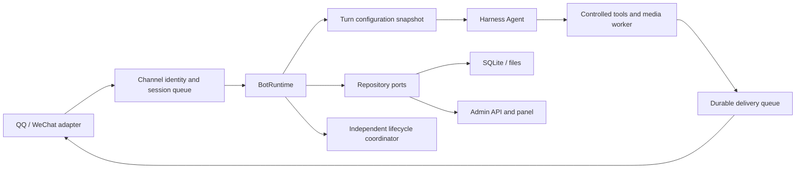

# Architecture

[简体中文](../architecture.md) | English

Harness owns the Agent loop, model calls, session logs and tool execution. The plugin owns QQ/WeChat integration, identity, personas, media, persistence and management UI. See [architecture boundaries](architecture-boundaries.md) for dependencies/extensions and [configuration](configuration.md) for operator settings.

## Runtime flow

`src/index.ts` composes ports and implementations. Application services use `src/core/ports/` for SQLite/file adapters; the panel consumes public API projections. Media workers receive host-resolved inputs and fixed operations, without owning identity, permissions or platform delivery.

## Identity, configuration and permissions

Channel identity owns sessions, attachments, memories and outputs. Models cannot supply trusted identity or local paths. Bots may share personas while channel ownership remains isolated. Each turn freezes persona, model, skill, tool and media configuration; edits apply next turn. Execution also checks current permissions, so revocation blocks subsequent calls.

Personas are edited through `config.json` and `persona.md`. Only `schemaVersion: 4` is supported; V3 is not read, migrated or used as fallback. SQLite revisions are the active snapshots; applying files validates schema, revision and file state. Bots keep independent runtime settings; persona switching retains history and session model/voice overrides. Harness credentials owns authorization secrets with a consistent mapping for valid bot IDs.

Ordinary and queued messages retain original text, current quotes and attachments. Attachment metadata/transcripts use internal context; time and working directory come from runtime context. Tools are disclosed on demand; raw tool JSON and reasoning are not sent to platforms.

## Sessions, workspaces and cleanup

Standalone shared runtime data lives under workspace `.runtime/`. Default and custom workspace roots append `<botId>/<scopeKey>`. Agents work under each channel's `sessions/<sessionId>/`, with ordinary artifacts in `outputs/`; sessions do not share a working directory.

DSH native logs own full history and recovery. Plugin SQLite holds bindings, history indexes and delivery records. Overview export or `session.export {id}` produces `history/<scope>/<sessionId>.jsonl` on request instead of rewriting it each turn.

Channel media storage is separate from session directories. SQLite records attachment IDs, source sessions, channel ownership and actual paths. Recent selection stays within the current session; explicit IDs can reuse older attachments from the same channel. Long-term memories also belong to the channel.

- **Delete session:** `session.delete {id}` stops the target and its owned child Agents, releases instances held by other interfaces, waits for writers and prevents reload during cleanup. It removes logs, projections, readable exports, the session directory and related records. Deleting the current session creates a blank replacement retaining persona/model/voice overrides; deleting history does not stop current work. Independent forks, channel attachments, memories, schedules and user files outside session directories remain.
- **Clean attachments:** Workspace filters registered attachments by kind, origin and cutoff, with usage statistics, preview and keep markers. Execution rechecks bot ownership and protects current sessions, busy scopes, queued/running jobs, pending or retryable deliveries and kept items. It does not delete unregistered files. Counts exclude native DSH attachments, logs and caches; deleting a session does not reclaim channel media capacity.
- **Delete bot:** Stop connections, tasks and automations, wait for writers, then remove authorization, owned sessions, attachments, memories and business records. Keep an identity tombstone against stale operations, shared personas and other user files. Failed cleanup can be retried.
- **Reclaim job directories:** Worker cwd/home/temp stay inside a per-job directory cleaned after execution. After exclusive runtime ownership, startup retries completed/interrupted job cleanup. Paths must match persisted workspace, scope and job ID; active jobs or live child processes defer cleanup until a later startup.

## Tools and media

| Entry | Responsibility |
| --- | --- |
| `media_download` | Download actual media from supported share links and return attachment IDs; no analysis or delivery by default |
| `media_analysis` | Accept attachment IDs and a question; host dispatches image/document/audio/video analysis |
| `media_transform` | Convert existing attachment format, size, quality or video GIF/MP4; no URL input |
| `image_generation` | Generate/edit through configured OpenAI-compatible services or ComfyUI workflows |
| `bot_voice`, `bot_music`, `bot_sing` | Speech, music acquisition and RVC conversion using shared jobs and attachment delivery |
| `bot_session` | Query, create, compact or resume sessions; host commands handle immediate stop |
| `bot_model`, `bot_voice_control` | Change current-session overrides for the next turn |
| `bot_skills` | Enable/disable skills on the shared persona, affecting sessions that use it |

`skills/catalog.json` and each skill's `operations.json` declare fixed entries, routes, parameters, model roles and delivery. Builds generate Host/Python registries. The host dispatches operation IDs; Python imports fixed `dsh_bot_runtime` entries from a trusted package root. Personas, workspaces and model responses never discover executable code; skills cannot send platform messages directly.

Media calls/retries are serial by default; explicit user requests allow concurrency. MediaService permits three concurrent calls and returns `MEDIA_CONCURRENCY_LIMIT` for a fourth. Local transforms also share up to three processing slots, with at most two per GIF. Waiting/running tasks can be cancelled; interrupted jobs are not replayed after restart. There are no daily call or cumulative video-duration quotas; file-size limits, 300-second video analysis, permissions and ownership still apply. A failed image request allows up to three additional model-directed retries.

Inbound audio uses channel transcripts when available, otherwise automatic ASR before the turn; failure stops the turn instead of guessing. Automatic TTS follows final text and is skipped after an explicit voice or STS attempt. Service Profiles freeze revisions and keep private endpoints, weights and credentials out of model projections. See [media delivery](qq-media-delivery.md) for QQ SILK, WeChat audio and limits, and [voice models](voice-model-library.md) for service constraints.

## Durable delivery and unknown outcomes

Delivery intent binds scope, session, turn and Asset; repeated registration reuses existing state. Recovery retains the original attachment and platform identity, with upload metadata persisted per attempt. Only connection failures proving the request never started receive automatic backoff retries. Unconfirmed submission becomes `unknown` and must not be blindly replayed. Earlier `unknown`/`failed` results do not permanently block later outputs in the turn.

Unconfirmed cancellation or remote state can fence a managed service until its state is resolved. Workers return stable business codes and sanitized diagnostics; the host validates output paths, formats, size, identity and execution-time permissions. See [repository responsibilities](repository-responsibility-matrix.md) for atomicity and recovery.

## Lifecycle and panel

Standalone products install both the main plugin and `dsh-bot-lifecycle`. The coordinator remains independent of the replaceable main plugin and negotiates versioned protocols, capabilities and artifact identities. The launcher validates installation records and artifacts. Compatible updates may drain and hot-replace the main bundle; incompatible pairs require offline dual-bundle updates. Failure allows one rollback to still-matching previous artifacts. See [ADR 0004](adr/0004-lifecycle-bundle-compatibility.md).

The panel organizes Overview, Bots, Services, Personas and Automation, with bot runtime, media, authorization and workspace managed independently. Writes use the admin API; UI never accesses the database directly. Third-party Service Adapter ABI is not available; see [adapter boundaries](service-adapter-abi-threat-model.md) for reasons and reassessment requirements.
