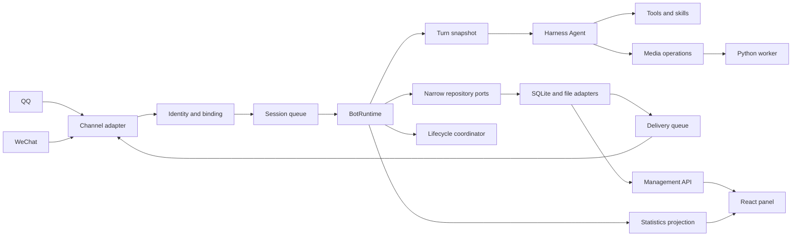

# Project Architecture

[简体中文](../architecture.md) | English

This QQ/WeChat plugin runs inside DeepSeek Harness. Harness owns the Agent loop, history, model calls, tool execution and lifecycle; the plugin owns channels, identity binding, personas, media, persistence and management UI. See [architecture boundaries](architecture-boundaries.md) for static dependency rules, composition-root exceptions and extension rules.

Standalone shared storage lives under workspace `.runtime/`. The installer moves old `sessions`, `storages`, `attachments` and updates native backend configuration. Channel workspaces default to bot ID/scope layers; attachments are classified by kind/purpose/date, with actual paths stored and ownership rechecked on reads. Worker cwd/home/temp are confined to a per-job directory and cleaned afterward. Each turn exports structured history under `history/`; configuration changes move old exports, while original engine logs remain authoritative for restoration.

## Runtime flow

## Core boundaries

- **Channels:** normalize platform events and restore platform targets before sending.
- **Identity:** scope derives from channel identity, account, conversation kind and sender, never model-provided identity/paths.
- **BotRuntime:** coordinates receipt, queues, commands, Harness turns, permissions and delivery.
- **Snapshots:** freeze persona/model/tools/skills/media at turn start; edits apply next turn.
- **Repositories/adapters:** applications see narrow `src/core/ports/` contracts. `src/infrastructure/sqlite/` persists bots, persona revisions, bindings, jobs, delivery, media and stats without changing schemas/error codes.
- **Media worker:** implementations reside in `python/dsh_bot_runtime/`, accepting only host-resolved attachments/fixed operations. The host launches with a controlled package root and `-P -m`; credentials are per-job, never persisted in config/results.
- **Management API:** summaries, paginated reads and protected commands; the UI never accesses storage directly.
- **Lifecycle:** independent bundle, not a main-plugin service. Buildable coordinator/integrity/protocol/entry live in `packages/bot-lifecycle/src/`; main connects through a neutral runtime port. Bidirectional protocol/API/package-range/capability/instance/artifact checks fail closed and keep lifecycle state outside mutable plugin logic.

## Lifecycle update boundaries

Standalone startup checks `installation.json` and `lifecycle-installation.json`: archive hashes, installed identities, versions and contracts must agree. Only a coordinator explicitly accepting the candidate may drain and hot-replace main. API/protocol-major/package-range/required-capability changes require launcher shutdown and trusted offline installation of both bundles; the old coordinator never replaces itself. Failure rolls back only still-matching previous main/coordinator artifacts once each. See [ADR 0004](adr/0004-lifecycle-bundle-compatibility.md).

## Configuration and personas

Each persona has `config.json`/`persona.md`. SQLite revisions are authoritative; files are editing inputs. Applying/saving validates schema, revision and fingerprints, creating a new active revision.

Bots can share personas but channel scope always isolates identities, sessions, attachments, memory and delivery. Persona/model switching does not reload active turns; main/subtasks retain startup snapshots.

`src/harness/credentials.ts` adapts Harness credentials. Compatible IDs retain `bot-integration/<id>`; other legal IDs use `bot-integration-encoded` and `id-` plus original-ID UTF-8 hex. Reads/writes/deletes share this mapping, allowing numeric/uppercase/underscore IDs without panel failures or collisions with old keys.

`bot.delete` first disables/archives, cancels connections, model work and pending delivery through the stop flow, deletes credentials, stops automation and awaits writes. It locates native session directories through the pinned JSONL backend, releases sessions, removes logs/projection caches and refreshes the public search index, then deletes the bot's messages/sessions/memory/assets/tasks/stats. Only an identity tombstone/shared personas remain; user working directories are preserved. Lists omit deleted bots and ordinary save/connect cannot revive them. Cleanup failure restores a retryable stopped state. Deletion clears QR attempts; pending QR/connect operations recheck bot status before resuming.

## Permissions

Channel identity, persona grants and current runtime state jointly determine permissions. Trust comes only from channel events and only for private chats. Tool execution uses the intersection of frozen/current permissions; revocation prevents subsequent calls and cancels cancellable work.

## Media and outputs

Images/audio/video/files enter workers through a unified registry; models cannot submit paths/scripts. Success, failure and unknown tasks feed delivery/statistics. Only networking failures proving no request was established may retry automatically.

Delivery records are stable intents and recovery entries. The same scope/Asset has one pending/accepted intent; reregistration across turns returns its status, not a new request. Unknown/failed recovery reuses the record/platform identity; only explicit recovery/resend semantics create a new intent when required. Unknown/failed earlier output does not permanently block later outputs in the turn. QQ upload credentials and WeChat CDN metadata persist per attempt for recovery. Only DNS, unreachable route, refused connection or connection-establishment timeout triggers two backoff retries at commit; other submission failures remain unknown with `cause.code`.

### Skill operation declarations

`media-analysis/operations.json` is the single declaration for tool parameters/routes, roles, quotas, source rules and automatic attachment delivery. Build generates a hashed immutable host registry from `skills/*/operations.json`; startup imports memory only, not skill files. On first skill execution Python validates the installed fixed `dsh_bot_runtime.skills...` entry and imports `execute(job)` by its unique package name. Jobs supply operation IDs, never caller module/script/package paths. Personas, chat and workspaces are not code discovery sources.

Add media operations by editing the skill declaration, Python implementation and documentation. Each `tools` entry supplies `tool`, ordered `routes`, `defaults`, optional `enabledRoles`/`permissionTool`. Defaults fill omitted selectors. Operation `role` selects `asr`, `video` or `tts`; absent role injects no model credentials. `deliver` registers attachments with the turn. Each operation belongs to one tool, possibly through multiple routes; compatible `bot_media` reuses source/permission/delivery rules.

`media_transform(operation, inputs, ...)` belongs to media-analysis but needs no analysis-model role or daily quota. `localTransform` shares `min(4, availableParallelism())` slots: one per image, up to two currently free per GIF. Waiters are FIFO; cancelled waiters leave immediately. Host-assigned `processingSlots` is a top-level worker field inaccessible to model arguments. Waiting/running work is cancellable and permissions are rechecked before execution. Restart marks queued/running jobs interrupted without replay. Other operations retain global-two/same-scope-one concurrency.

Trusted private media is exempt from daily call/cumulative-video-second quotas. MediaService checks the real binding, host TurnSnapshot and current trust list; new trust applies next turn, revocation immediately. Top-level host-owned `dailyQuotaExempt` reaches video services, never through tool arguments. Usage/jobs remain recorded; per-file size, 300-second single-video, concurrency and isolation limits remain. Attachments have no per-channel or global cumulative storage cap: historical totals do not block receiving or generating new attachments, or cause old files to be deleted. Groups/untrusted private chats keep daily quotas.

Images combine orientation, resize, conversion and compression after one decode. GIFs use a common frame grid and roughly 15-second parallel segments; videos below 30 seconds or one-slot work encode whole. Segments begin with opaque full frames and retain local palettes. Merge parses generated GIF blocks, copies compressed pixels, normalizes centisecond delays/loops and never reencodes pixels. Output must be strictly below 10,000,000 bytes, allowing at most four quality-reduction rounds without shortening duration or dropping below 12 fps. Full decode precedes Asset registration; host cleans the job directory and records `cleanupError` if cleanup fails.

Inbound audio prefers channel transcription; otherwise runtime runs ASR before the model and writes real transcription back to the message. Failure stops the turn rather than guessing. Voice-generation produces an audio Asset for the existing queue. QQ derives SILK bubbles, fully segments above 300 seconds and attaches a full MP3 with independent part states. WeChat initially uses playable ordinary audio files.

Only V4 personas are accepted. `media.voice` selects GPT-SoVITS/Breeze by `profileRef` or built-in `protocol: edge_tts`; `replyMode` is `on_demand`/`auto`. Addresses, weights, references, Breeze voice IDs and languages are private Profile fields; tools supply text/speed and other business input only.

GPT-SoVITS serializes by address and always performs `set_sovits_weights → set_gpt_weights → set_refer_audio → tts`. Jobs bind frozen Profile revisions; the host owns revocation/cancellation/session checks.

Breeze serializes `/v1/audio/speech`, fixes WAV output and requires 24 kHz in health. Explicit panel Start runs only a fixed external launcher. Refresh, synthesis and plugin exit do not own Breeze's process; uncertain server state after cancelling submitted work fences it.

Automatic speech runs after final text and before delivery segmentation, for ordinary and automated turns. `HarnessResult.voiceAttempted` suppresses automatic resynthesis even after an explicit failure. Delivery retries only existing assets. Ordinary synthesis failure retains text; revoked permissions/invalid context stop delivery. Management separates configuration completeness from revision-bound synthesis acceptance.

Namespaced skills expose `execute(job)` returning common text/attachments/coverage. Only valid business codes defined by `dsh_bot_runtime` cross processes; unknown exceptions become stable fallbacks without type names, traces, interpreter/endpoints/credentials/model paths or download locators.

The host owns permission intersections, attachment resolution, model credentials, audio adaptation, quotas, cancellation, output paths and delivery. Custom persona skill directories never discover executables; Python uses packaged fixed entries only. Broken optional declarations affect their own operations without blocking documents/images/others, with updates effective after restart. Once-per-turn image generation, native image understanding, documents and MP4 conversion retain host implementations; `convert_gif` is skill-provided.

### GPT-SoVITS Limitations / Known Issues

One bot process exclusively owns a service. Restart before first use and before changing language/frontend meaning of old reference text to clear caches. Loading models per request costs time; local-worker cancellation does not prove inference stopped. Resources/version support require independent setup/acceptance.

### Breeze TTS Limitations / Known Issues

Voices must be saved server-side and listed by `/v1/voices`; unavailable service/deleted voices make Profiles unavailable. Explicit configured Start may run `Start-Breeze.ps1`, but refresh/synthesis/exit never automatically manage the process. No speed control; Japanese is experimental. Actual audio/delivery needs independent acceptance.

### RVC voice conversion

`media.singing` is separate, default-off STS and shares no target weights/references with voice. `bot_sing` requires STS enabled, tool permission and `singing-conversion`. It owns prepare/list/convert candidates and one-turn attempts; compatible `bot_media` cannot call `singing_convert`. The host supplies addresses, paths and job IDs.

Persistent candidates bind scope/session/generation/set ID. The host resolves session audio/file attachments or retains real-search public URLs/titles/available license info. Worker reuses download/extraction; known mixed audio without separation is rejected before download, unknown type asks the user. Private separation settings hold model ID/weights/remix/volume and default off; complete settings enable vocals-first conversion/remix. Explicit user conversion requests/waiting uploads may bypass ASR; ordinary voice still transcribes.

Host serializes normalized addresses; HTTP service adds a single-slot FIFO and a dedicated RVC child per job. Runner validates checkpoint/F0/speaker/index dimensions before RMVPE conversion. Unique host job IDs deduplicate submissions; a lost response queries status without inference replay. The surviving host cancels directly, releasing only after tree exit; unknown fences the service until idle.

Service WAV is encoded as MP3/WAV and checked for full decode, valid frames, non-silence, duration and size. One success registers one session audio Asset and uses durable delivery. Failure/cancellation/unknown never switches source or reruns. `HarnessResult.singingAttempted` suppresses extra automatic TTS. Permissions/session identity are checked at queuing, execution and registration.

Management reports configuration, RVC protocol, separation protocol/model completeness and real `singing` acceptance, with revision-bound evidence. `skill.singing.probe` calls health without inference; operators record actual full-output/listening acceptance. Model-visible projections strip addresses and RVC/separation paths.

## Panel

Overview, Bots, Services, Personas and Automation show runtime/bot status, health and token use. Bots has Run, Media, Persona, Authorization and Workspace; Run contains model/reply behavior, while Personas manages prompts/files. Writes use management APIs and configuration applies next turn.
