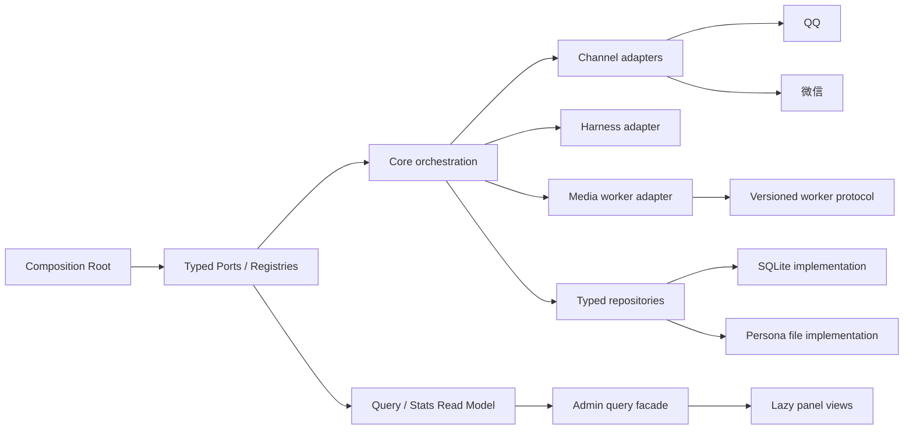

# wechat_ai 重构计划

状态：草案  
日期：2026-10-22  
范围：面板信息架构、响应性能、安全收口、模块扩展性和持久化边界

## 1. 结论与目标

当前项目适合两种渠道、单进程和现有媒体能力的规模。核心处理链已经可工作，测试覆盖也较完整；继续增加第三渠道、更多媒体操作或更多管理面板时，修改会扩散到类型、运行时、权限、统计、Admin、客户端和 Python worker。

本计划的目标是：

- 保持现有 QQ / 微信行为和会话数据兼容。
- 将面板从七个顶层入口收敛为三个生命周期域。
- 降低消息从接收至投递的 p50 / p95 延迟。
- 让新增渠道、媒体操作和管理能力通过注册表或 port 接入。
- 让 SQLite、文件系统和 Harness 依赖集中在 adapter / implementation 层。
- 修复会导致 SSRF、权限绕过、无限增长和资源滥用的风险。

本计划采用“兼容 facade + 渐进迁移”。`BotRuntime`、`ChannelAdapter` 和现有测试作为迁移护栏，不进行一次性重写。

## 2. 当前基线

最近一次本地验证：

| 检查 | 结果 | 说明 |
|---|---|---|
| TypeScript 测试 | **PASS** | 160 个测试通过 |
| Typecheck | **PASS** | `npm run typecheck` |
| Build | **PASS** | `npm run build` |
| Python 测试 | **INCOMPLETE** | 4 个用例受 `docx`、`pypdfium2`、`aiohttp` 缺失影响 |
| npm audit | **BLOCKED** | 当前 registry 返回 HTTP 405，不能据此判定无漏洞 |

审计针对当前工作树；工作树存在未提交修改和新增文件。任何阶段开始前都应记录当前基线、数据库副本和测试结果。

## 3. 主要问题

### 3.1 架构与耦合

- `src/core/runtime.ts` 同时管理连接、Inbox、debounce、命令、session-action、附件物化、Harness turn、权限撤销、投递和升级排空。
- `src/harness/bridge.ts` 同时管理 Agent 生命周期、提示词、权限、终端、子 Agent、技能、统计、媒体和业务工具。
- `src/core/store.ts` 同时负责 SQLite schema、迁移、人格文件恢复、配置、会话、Inbox、Delivery、记忆、资产和运行锁。
- `src/core/stats.ts` 直接访问 `store.db`，绕过 Store 接口；Admin、Runtime、Features 和 Skills 也直接使用泛型 `get/list/put`。
- `src/core/evolution.ts` 直接依赖 `src/lifecycle/protocol.ts`；两个 bundle 通过 `globalThis` 和 `Symbol.for` 共享隐式协议。
- 新的 management / session-action seam 已经建立，但旧斜杠命令仍在 Runtime 中保留一套逻辑，可能导致行为和权限漂移。
- 没有发现明显的 TypeScript import cycle；主要问题是反向依赖、时序耦合和跨层知识泄漏。

### 3.2 面板与管理接口

当前面板有 `stats`、`evolution`、`bots`、`configs`、`sessions`、`memory`、`capabilities` 七个 tab。`configs` 和 `capabilities` 已经共用同一渲染分支；机器人页和配置页重复提供人格目录操作。

Admin 使用字符串 action switch，`state` 返回完整配置、绑定、任务、异常、投递和版本；客户端直接依赖这些原始结构。主刷新每 4 秒串行请求多个接口，统计和自进化页面又各自轮询。

目标信息架构：

1. **总览 / 运行**：统计、在线状态、任务、异常、投递、自进化时间线。
2. **机器人 / 授权**：账号、启停、重连、配置绑定、可信用户、工作目录。
3. **人格 / 模型 / 媒体**：人格文件、版本、模型、工具、技能和媒体能力。

会话、投递记录和长期记忆改成选中会话后的详情区域。

### 3.3 响应性能

- 默认 debounce 为 2 秒。
- `bridge.run()` 等待完整 turn、`whenIdle()` 和 `sessions.flush()` 后才产生最终投递，没有首包或中间反馈。
- pending 消息没有统一批次上限；inbox、session、delivery、job 和 skill archive 缺少完整 retention / GC。
- 投递按 bot 全局串行，并反复扫描 deliveries。
- Stats 每次从全量统计记录、inbox 和 deliveries 重算。
- 面板刷新缺少 single-flight、取消和 revision guard，可能重叠请求并用旧响应覆盖新状态。
- Runtime 没有统一 turn deadline；模型或工具卡住时会长期占用一个 scope。
- 微信接收循环逐条等待 `receive`，命令或模型校验期间会暂停继续拉取。

### 3.4 安全

现有正向控制包括 loopback + bearer 管理认证、Harness credentials、scope / asset ownership、可信私聊 host 权限和附件公网地址校验。

必须纳入重构门槛的风险：

- 视频远程 URL 只校验 HTTPS，存在任意公网 SSRF 和带宽滥用路径。
- 图片 provider 返回的 URL 没有统一 DNS、公网地址和端口策略。
- `bot_media` 兼容入口需要与 `bot_read_social` 的独立权限保持一致，避免面板关闭权限后仍能调用。
- 入站消息、prompt、question、URL、附件数量和总大小缺少统一 hard cap。
- 媒体解析直接执行 ffmpeg / ffprobe，worker 环境还可能继承 provider key，缺少低权限隔离。
- `allowHostTools` 默认值偏宽；共享人格的修改可能影响绑定同一配置的其他 bot。
- token 放在全局 `window`，同源脚本可调用全部管理动作；会话、路径和历史返回过多。
- inbox、delivery、session、job、skill archive 和媒体索引没有统一清理策略。

## 4. 目标架构

目标 port / seam：

- `ChannelRegistry` / `ChannelDefinition`：渠道 ID、显示信息、能力、登录策略、adapter、credential codec、reply codec。
- `ConfigRepository`、`SessionInboxRepository`、`DeliveryRepository`、`AssetRepository`、`StatsReadModel`。
- `CommandBus` / `ManagementCommand`：斜杠命令、自然语言控制和管理工具使用同一套授权与排队逻辑。
- `CapabilityRegistry`：工具名、输入 schema、权限、并发策略和 Admin handler 只登记一次。
- `MediaOperationRegistry` / `WorkerPort`：TS 与 Python 使用版本化 JSON 协议和统一 operation descriptor。
- `LifecyclePort` / `SessionHistoryReader`：core 不直接依赖 lifecycle bundle 或 Harness 类型。
- `UsageEvent`：Harness 事件先转换为稳定事件，StatsProjection 不读取原始 Harness event 或 raw DB。

## 5. 分阶段实施计划

### Phase 0：基线、护栏和安全止损

目标：在移动模块之前锁定行为和风险边界。

任务：

- 增加 inbox → turn → outbox 的阶段时间戳和 p50 / p95 统计。
- 增加 turn deadline、批次大小、消息总字节、附件总字节、媒体 prompt / URL 长度上限。
- 统一 URL policy：固定允许 host 或仅允许受控附件，逐跳 DNS pin，禁止私网、非 443 和未验证重定向。
- 修复兼容媒体入口的独立权限检查；默认关闭 `allowHostTools`，可信用户增加时显示影响范围。
- 为 inbox、delivery、session、job、skill archive 建立保留窗口、每 scope 上限和全局磁盘上限。
- 为 SQLite 查询增加当前必要索引，但暂不改变领域 schema。

验收：

- 现有 160 个 TypeScript 测试继续通过。
- 新增超限、SSRF、权限撤销、turn 超时和 retention 测试。
- 记录基线 p50 / p95，不允许性能回归超过现有基线 10%。

### Phase 1：面板查询与命令入口收口

目标：减少面板请求和重复管理逻辑。

任务：

- 定义 `AdminQuery`、`AdminCommand`、版本化 DTO 和 `revision` / `changedSince` 字段。
- 把 `state` 改成摘要查询；任务、投递、历史、版本和目录按需分页读取。
- 前端使用 single-flight、AbortController 和 revision guard；统计和自进化改为按 tab 懒加载。
- 将七个 tab 收敛为三个域；移除重复的配置目录入口。
- 把旧 slash command、自然语言 control 和 `BotManagement` 适配到一个 `CommandBus`，再删除 Runtime 中重复 switch。

验收：

- 初始加载请求数减少到一个摘要请求或一个合并快照请求。
- 页面不会因为历史规模增长而全量渲染 session、delivery 或 event。
- command / tool / Admin 三条入口对同一操作使用同一授权和排队测试。

### Phase 2：渠道注册表与身份模型

目标：新增渠道时不修改核心处理链。

任务：

- 用 `ChannelRegistry` 替代 `Record<'qq'|'weixin', ChannelAdapter>`。
- 将 `CallerScope.platform`、登录状态和凭据改为可注册 ID 与 opaque adapter-owned data。
- 将 `Delivery.reply: Record<string,string>` 改为 adapter 定义的 normalized envelope。
- 将微信 cursor 和 QQ group observation 改为 `CursorStore` / `ChannelEventSink` port。
- Admin 和 UI 从 registry 读取渠道能力、登录方式和群支持信息。

验收：

- QQ / 微信 adapter contract tests 覆盖登录、connect、materialize、send、回执幂等和取消。
- 新增 fixture channel 只需注册 definition 和 adapter，不修改 Runtime、Stats 和面板核心逻辑。

### Phase 3：Typed repositories 与增量统计

目标：收窄 Store interface，消除 raw DB 依赖。

任务：

- 保留 `SqliteStore` implementation，先增加 typed repository facade。
- 迁移 Stats，禁止 `StatsService` 使用 `store.db.prepare`。
- 将 inbox、delivery、session、asset、job 查询改成按 scope / 状态 / 时间分页。
- 将统计改为事件投影或增量 read model，保留未知 usage，不重复计数。
- 将 PersonaFiles 与 ConfigRepository 的双写恢复逻辑集中到一个实现。

验收：

- dependency-rule test：core 业务模块不能访问 `store.db` 或泛型 kind 字符串。
- repository contract tests 覆盖 SQLite 实现、分页、索引、恢复和 retention。
- `stats.query` 的扫描量与历史总量脱钩，查询时间在固定数据规模下保持稳定。

### Phase 4：Runtime 内部拆分

目标：保留 `BotRuntime` facade，拆开状态机和时间约束。

建议的内部模块：

- `ConnectionSupervisor`：bot 连接、重连和凭据失效。
- `TurnCoordinator`：scope debounce、批次、取消、deadline 和 turn snapshot。
- `CommandDispatcher`：控制命令统一排队和授权。
- `SessionActionExecutor`：new、stop、compact、resume、persona、skill。
- `DeliveryWorker`：按 scope 保序、按 bot 并行、状态 cursor 和未知回执冻结。
- `RuntimeLifecycle`：initialize、quiesce、resume、close。

验收：

- `BotRuntime` 外部构造方式暂时兼容。
- 每个内部模块有独立取消、恢复和顺序测试。
- inbox → harness、harness → outbox、outbox → sent 均有 p50 / p95 指标。

### Phase 5：Harness、媒体和生命周期 adapter

目标：让 core 不依赖具体 Harness、worker 和 lifecycle 实现。

任务：

- 将 `NativeHarness` 拆为 AgentSessionHost、PromptAssembler、PermissionBinder、ToolRegistrar、StatsEventAdapter、MediaToolAdapter。
- 用 `CapabilityRegistry` 管理业务工具、schema、授权和并发策略。
- 用 `MediaOperationRegistry` 替代 TS union、Bridge enum 和 Python giant switch。
- 为 worker job 建立版本化 schema，统一 timeout、quota、输入输出和 usage journal。
- 将 `EvolutionService` 依赖改成 `LifecyclePort`；把两个 bundle 之间的 global Symbol 协议改为版本化握手。
- 将构造期副作用改为显式 `open / initialize / migrate / recover / start` 阶段。

验收：

- core 层只依赖 port，不直接 import `@deepseek-ai/*` 运行时实现。
- media operation 增加 fixture handler 时，不需要修改多个 switch。
- lifecycle bundle 缺失、版本不兼容或 runtime 未注册时均 fail closed。

## 6. 重构约束

- 不在同一个提交中同时改变数据库 schema、Runtime 状态机和平台投递语义。
- 每次只迁移一个 caller，保留兼容 facade，确认测试通过后再删除旧路径。
- 不把 `Store` 泛型 `get/list/put` 继续扩散到新模块。
- 不以文件拆分代替 seam；每个新模块必须有清晰 interface、错误模式、取消语义和性能特征。
- 新增第三渠道前必须先完成 Phase 2；新增大媒体能力前必须先完成 Phase 0 和 Phase 5 的 operation registry。
- 任何远程发布、推送、打包发布或线上升级仍需单独授权。

## 7. 性能与安全验收指标

性能指标：

- 记录接收、排队、附件处理、模型首反馈、完整 turn、投递开始和平台回执时间。
- 报告 p50、p95、最大排队深度、单次批次消息数、单次输入字节数和投递失败率。
- 面板摘要查询记录响应时间、返回行数和 payload 字节数。
- 统计查询不得随着历史总行数线性增长到阻塞消息事件循环。

安全指标：

- 所有远程 URL 经过统一 policy；禁止私网、非允许 host、未验证重定向和超额下载。
- 所有入站消息、媒体参数和模型工具参数经过总字节和字段长度限制。
- 管理 token 不作为长期全局凭据暴露；高风险 action 有 action-level authorization 和审计记录。
- 媒体 worker 使用最小环境、固定工具路径和低权限进程隔离。
- 默认配置不授予 host 工具；共享人格变更显示受影响 bot 并重新确认。

## 8. 回滚与完成定义

每个 phase 都应保留上一版 facade 和数据库备份。出现以下任一情况时停止迁移并回滚当前 phase：

- 会话归属、权限撤销或未知投递回执语义改变。
- 任何历史消息或人格文件无法恢复。
- p95 响应时间超过基线 20%，且没有明确的容量收益。
- `PASS` 证据退化为 Host-only、静态或未完成状态。

整个重构完成的条件是：

- 现有渠道行为和会话数据兼容。
- 新增 fixture channel 可通过 registry 接入。
- 新媒体 operation 只需注册 descriptor 和 worker handler。
- core 不直接读取 raw SQLite 或具体 Harness event。
- 面板使用 typed query / command contract，并按需加载历史。
- TypeScript、Python、typecheck、build、release scan 和性能回归均有明确 `PASS`；缺失依赖或远程漏洞服务不可用时保留 `INCOMPLETE` / `BLOCKED`，不提升为通过。
